# Assignment 6 — Capstone Assignment — Deploy Book Review App (Three-Tier Architecture) on AWS

Part of the DevOps Micro Internship (DMI) with Agentic AI

---

## Purpose

This is the most important assignment of the course. You will deploy the Book Review App in a fully production-style three-tier architecture on AWS: a Next.js Web Tier behind Nginx and a public ALB, a private Node.js/Express App Tier behind an internal ALB, and a private Multi-AZ MySQL RDS database with a read replica. You are expected to design, deploy, isolate, debug, and document the result independently.

---

# Task 1 — Architecture Diagram

## Goal

Create an architecture diagram showing the custom VPC (10.0.0.0/16), the six subnets across two Availability Zones (two public Web Tier, two private App Tier, two private Database Tier), the public ALB, Web Tier EC2/Nginx, internal ALB, private App Tier EC2, private Multi-AZ RDS with its read replica, and the permitted traffic flow.

### Evidence

#### Diagram image or link

---

# Task 2 — AWS Region & Services Used

## Goal

Record the AWS Region used and list every AWS service used across networking, compute, load balancing, security, and the database.

### Notes

**Region:**

Stockholm (eu-north-1)

---

**Services:**

Amazon VPC, Internet Gateway, 6 subnets, NAT Gateway, Route tables, Amazon EC2, Application Load Balancers, Amazon RDS MySQL, RDS read replica, Security Groups, etc

---

# Task 3 — Public Entry Point

## Goal

Confirm the Book Review App loads through the public ALB DNS name.

### Evidence

#### Public ALB DNS

Paste your public ALB DNS name here:

http://book-review-web-alb-1997429571.eu-north-1.elb.amazonaws.com/

---

# Task 4 — Evidence Screenshots

## Goal

Capture visual proof of every tier and load balancer.

### Evidence

#### Web EC2

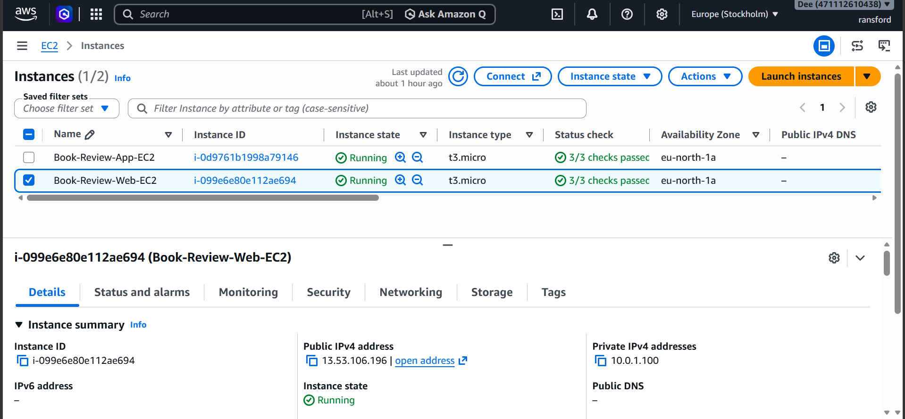

---

#### App EC2

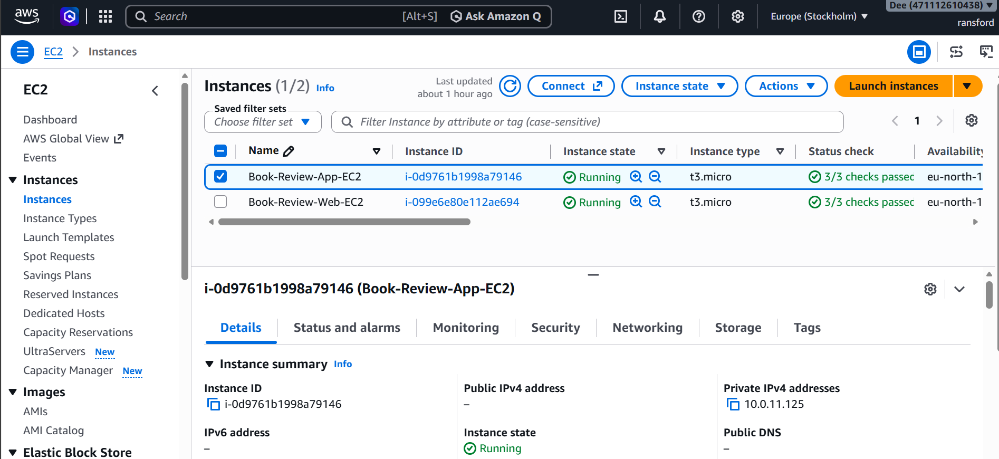

---

#### Public ALB

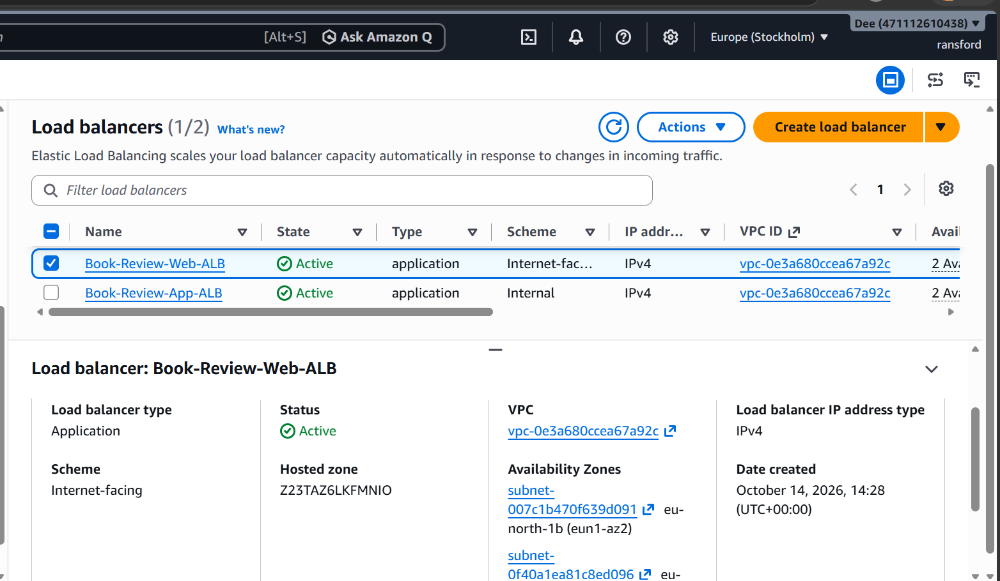
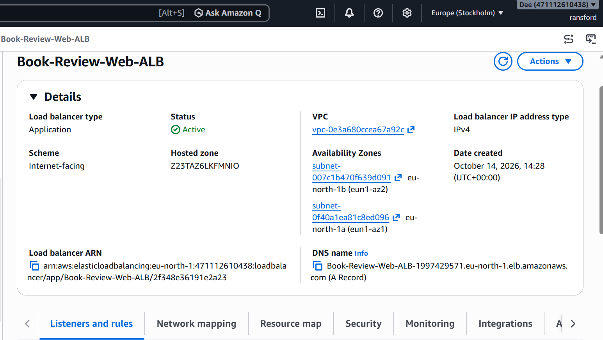

---

#### Internal ALB

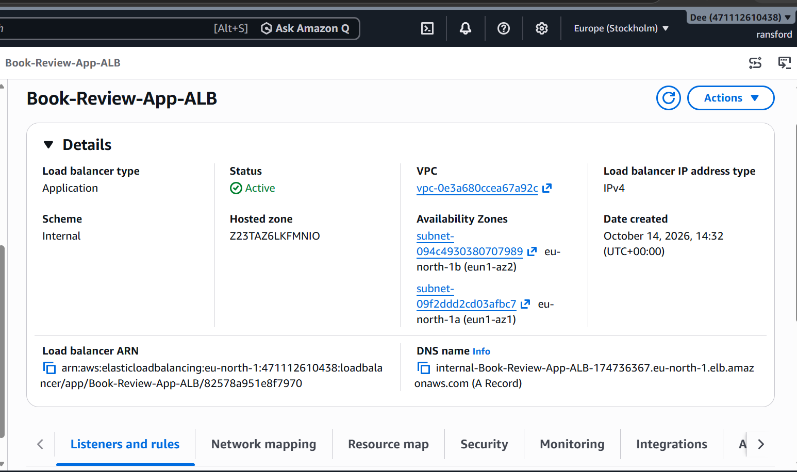

---

#### RDS + Replica

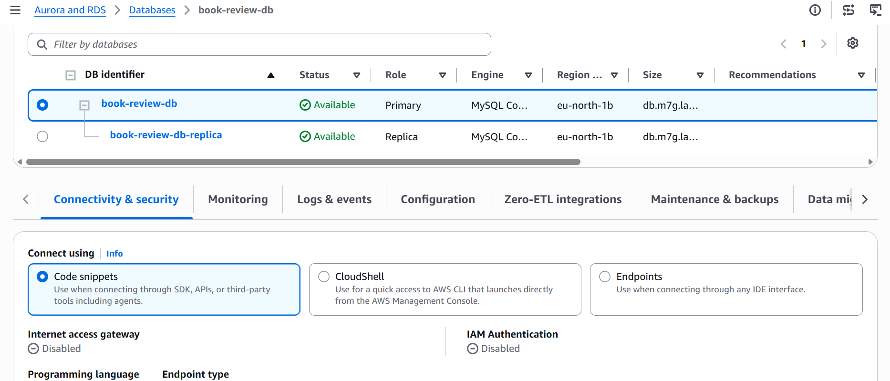
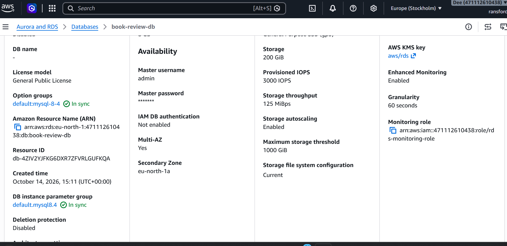
---

#### App UI proof

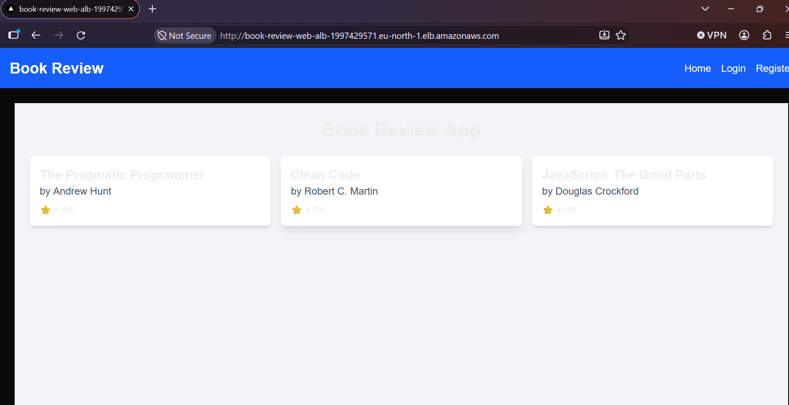

---

# Task 5 — Summary

## Goal

Summarize what worked in the final deployment, the issues encountered and how each was fixed, and the tools or sources used to research and debug.

### Notes

**What worked:**

Deployed Next.js and Nginx on the web EC2 instance and Node.js/Express on the private application EC2 instance.
Configured two ALBs with healthy targets.
Connected the backend securely to MySQL over SSL; confirmed the API returned HTTP 200 and book data.
Enabled RDS Multi-AZ and created a read replica.
Verified that the public website displayed three book records.

---

**Issues + fixes:**

RDS connection timeout
Checked RDS endpoint, MySQL port 3306, security groups and network connectivity; restored database access.

No books available on frontend
Fixed duplicated /api in the frontend API URL configuration and restarted the frontend.

PM2 process name mismatch
Used pm2 list to identify the correct process name: frontend.

Public Web ALB timeout
Found the ALB was associated with a security group blocking HTTP; attached a security group allowing inbound HTTP.

Backend startup issues
Ran the server from the correct backend directory and resolved a port 3001 conflict.

---

**Tools/sources used:**

### Tools and Technologies Used

The tools and technologies used for this project include AWS Management Console, Amazon VPC, Amazon EC2, Application Load Balancer, Amazon RDS MySQL, Ubuntu Linux, SSH, Nginx, Node.js, Express.js, Next.js, PM2, MySQL Client, and cURL.

---

# LinkedIn Post (Required)

## Goal

Publish a LinkedIn post sharing the capstone deployment, including the public ALB DNS (or a redacted screenshot), three to five lines on what you built and why it is production-style, and one proof screenshot.

## Evidence

#### LinkedIn Post URL

Paste your LinkedIn post URL here:

https://www.linkedin.com/posts/ransfordselormdzandu_cloudengineering-devops-dmiabrwithabrpravinmishra-share-7517503499295825920-CPYS/?utm_source=share&utm_medium=member_desktop&rcm=ACoAAEwl7_QBxhr73Ja5tGLqw7xByGHiHbrAk08

---

#### Screenshot of LinkedIn post

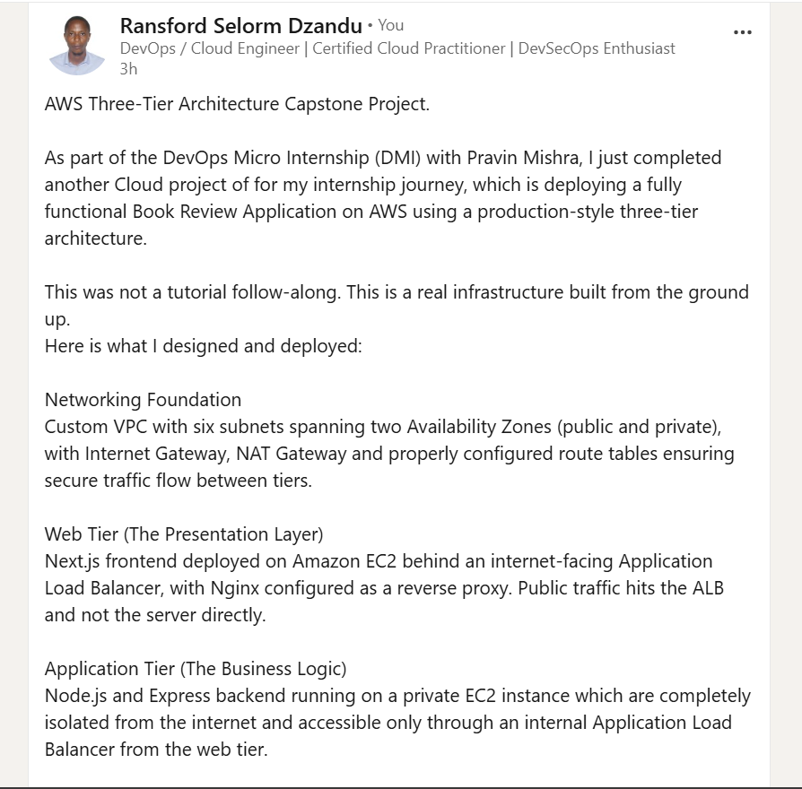
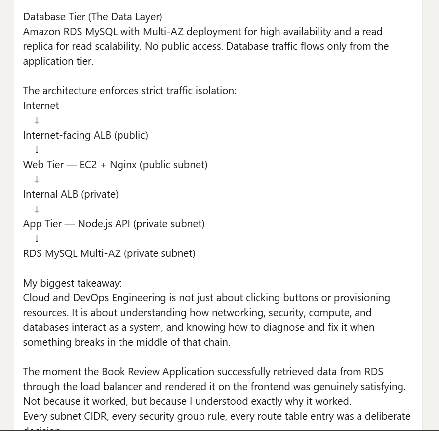
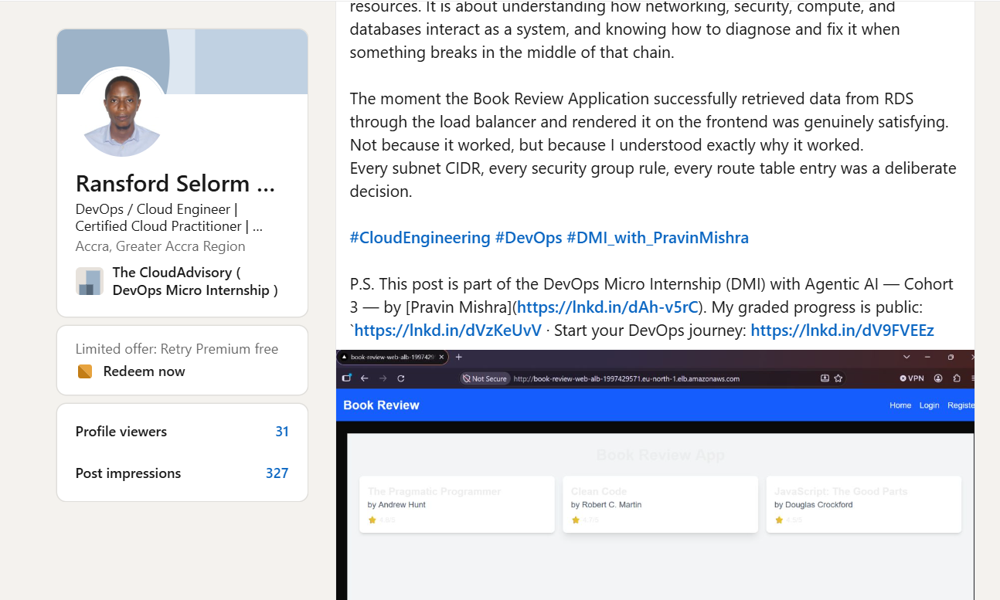

---

# Submission Instructions

- Add all required screenshots and links in your submission
- Do not expose passwords, RDS credentials, connection strings, private keys, or account IDs

---

# Completion Checklist

- [ ] Task 1: Architecture diagram completed
- [ ] Task 2: AWS Region and services documented
- [ ] Task 3: Public ALB DNS confirmed working
- [ ] Task 4: All six evidence screenshots captured (Web Tier, App Tier, both ALBs, RDS + replica, app UI)
- [ ] Task 5: Deployment summary completed (what worked, issues/fixes, tools/sources)
- [ ] LinkedIn post published and URL submitted
- [ ] App Tier and Database Tier confirmed not publicly accessible
- [ ] No sensitive data exposed

---

## 📌 About DMI & CloudAdvisory

DevOps Micro Internship (DMI) is a project-based DevOps program run by Pravin Mishra (The CloudAdvisory) focused on real-world execution, systems thinking, and career readiness.

It helps learners build strong DevOps foundations with hands-on experience.

---

## 📌 Resources

- 🌐 DMI Official Website: https://dmi.pravinmishra.com?utm_source=github&utm_medium=readme  
- 🎓 University: https://university.pravinmishra.com?utm_source=github&utm_medium=readme  
- 💬 Discord Community: https://discord.pravinmishra.com?utm_source=github&utm_medium=readme  
- 📝 Blog: https://dmi.pravinmishra.com/blog?utm_source=github&utm_medium=readme  
- ▶️ YouTube Playlist: https://www.youtube.com/playlist?list=PLFeSNDtI4Cho  
- 🔗 Pravin Mishra (LinkedIn): https://www.linkedin.com/in/pravin-mishra-aws-trainer/  
- 🏢 CloudAdvisory (LinkedIn): https://www.linkedin.com/company/thecloudadvisory/

---

*This submission is part of DevOps Micro Internship (DMI) — Agentic AI Track.*