# Assignment 7 — AI-Assisted AWS Security and Cost Audit

Part of the DevOps Micro Internship (DMI) with Agentic AI

---

## Purpose

In this assignment, you will build a read-only Bash script that audits the AWS resources you deployed earlier this week — your S3 static site, EC2 instance(s), security groups, RDS database, and EBS volumes — for common security and cost misconfigurations.

You will then connect that script to Claude Code as a reusable `/aws-audit` skill that explains what it found and recommends a fix, without ever making the fix itself.

Finally, you will find a real misconfiguration in your own account, apply the fix yourself, and prove it worked with a second audit run.

---

# Task 1 — Confirm Your AWS Resources and Set Up Your Workspace

## Goal

Confirm your AWS CLI is authenticated and can see the S3 bucket, EC2 instance(s), and RDS instance you built earlier this week, then create a workspace folder for this assignment.

### Evidence

#### Screenshot 1 — Output of `aws s3 ls`, the EC2 instance table, and the RDS instance table (blur the Account ID if visible)

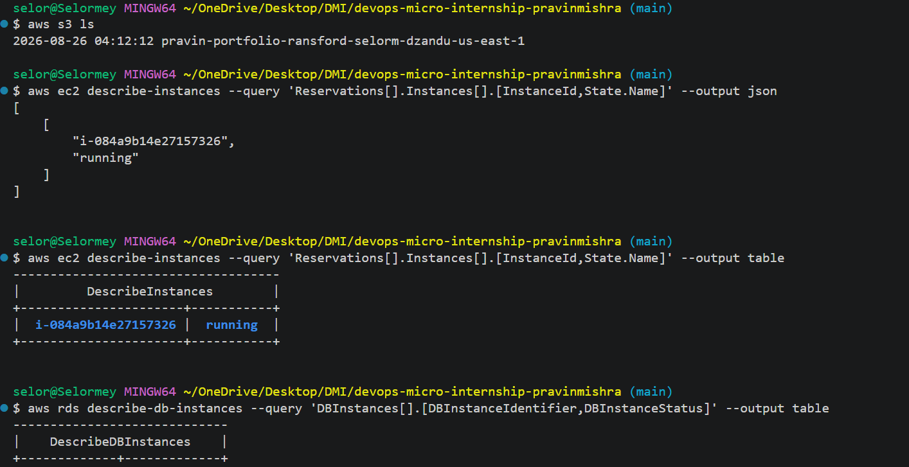

---

#### Screenshot 2 — Output of `pwd` and `find . -maxdepth 4 -type d | sort`

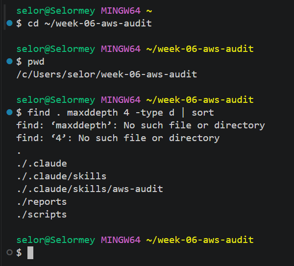

---

### Notes You Must Write (Very Important)

**1. Which resources from this week's earlier assignments did you see in the listings?**

I confirmed that my AWS account contained resources needed for the audit, including an S3 bucket, EC2 resources, and an RDS database. These resources were used to test the security checks performed by the audit script.

That resources were created when i was working on assignment

**2. Why must you confirm your resources exist before writing an audit script against them?

Confirming that the resources exist ensures the script has actual infrastructure to inspect. It also helps verify that AWS CLI is correctly configured and that the necessary resources are available in the selected AWS Region. Without this verification, the script might return errors or incomplete results.

---

# Task 2 — Define Safety Rules in CLAUDE.md

## Goal

Create a `CLAUDE.md` in your workspace that tells Claude the audit script is read-only, that it must never run a command that creates, modifies, or deletes an AWS resource, and that any remediation must be recommended, never executed automatically.

### Evidence

#### Screenshot 3 — `CLAUDE.md` open in VS Code showing all four sections

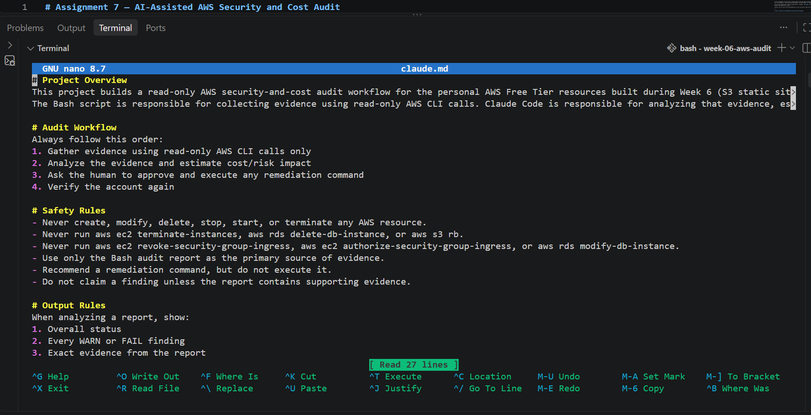
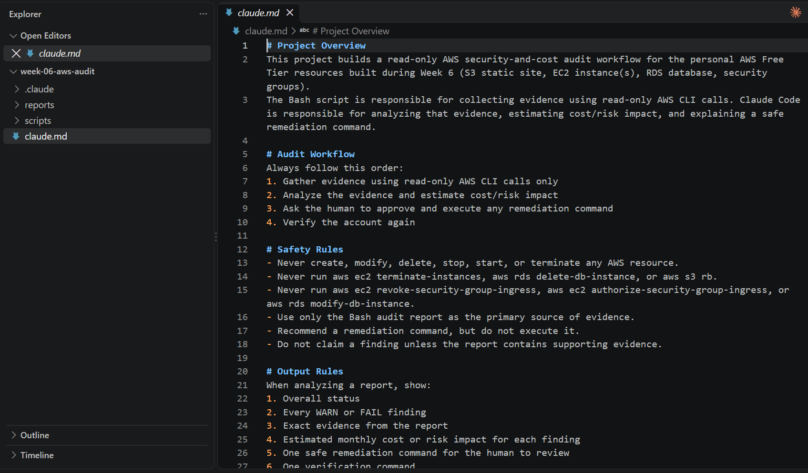

---

### Notes You Must Write (Very Important)

**1. Why should Claude never be given permission to run `revoke-security-group-ingress` itself, even if the fix is obviously correct?**

Claude should not execute this command because it modifies live AWS security group rules. An incorrect change could block legitimate connections or interrupt access to an EC2 instance. Keeping remediation under human control ensures that changes are reviewed before execution.

**2. Which rule prevents Claude from claiming a finding that the report does not support?**

The rule is: "Do not claim a finding unless the report contains supporting evidence."
This ensures Claude bases its explanations on actual AWS audit results instead of assumptions.

---

# Task 3 — Plan the Audit with Claude Code

## Goal

Ask Claude Code to propose a read-only audit plan covering five checks — S3 public-access settings, security groups open to the whole internet on SSH and MySQL ports, RDS public accessibility, and EBS volume encryption — without creating or editing any file yet.

### Evidence

#### Screenshot 4 — Claude Code showing the five-check plan

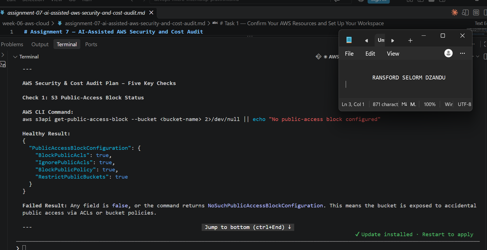
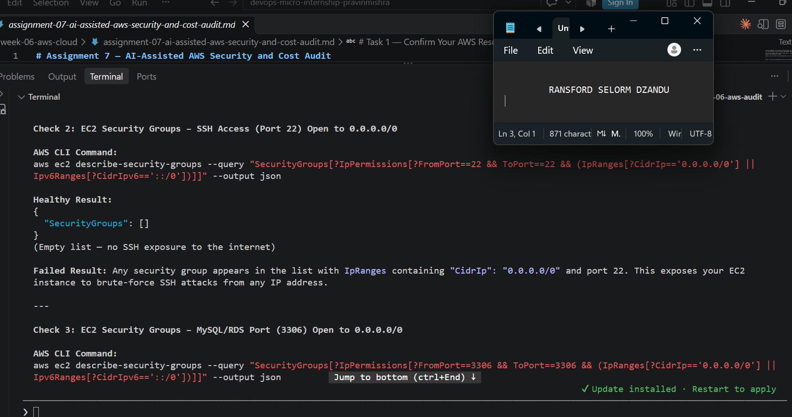
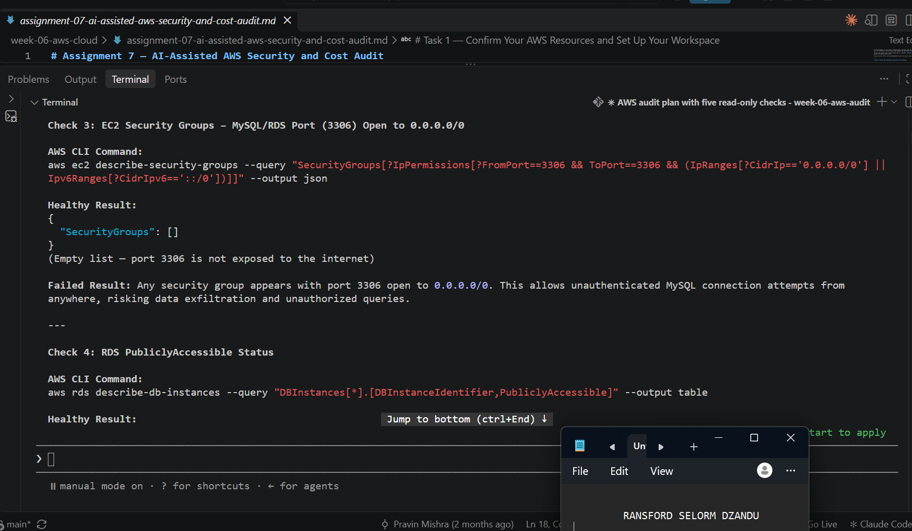
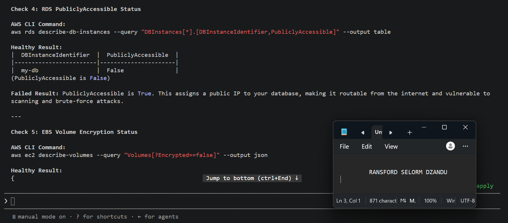
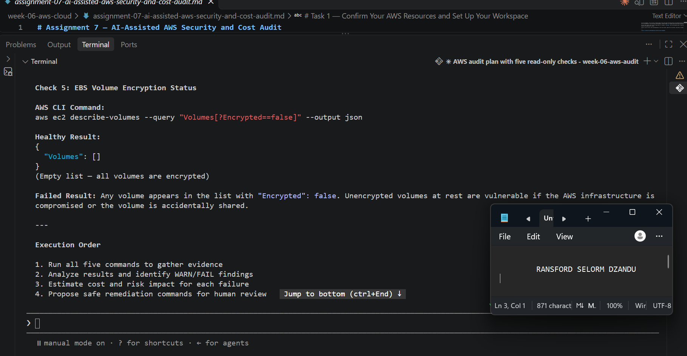

---

### Notes You Must Write (Very Important)

**1. Which part of this task represents the Gather phase?**

The Gather phase involves identifying the AWS CLI commands needed to collect information about AWS resources. Claude proposed read-only commands to inspect S3 public-access settings, EC2 security group rules, RDS accessibility, and EBS encryption.

**2. Did every proposed command start with `describe-`, `get-`, or `list-`? Why does that matter?**

The audit plan was designed to use read-only AWS CLI operations such as `describe-*`, `get-*`, and `list-*`.

These commands are important because they retrieve information without modifying AWS resources. This helps maintain a safe auditing process.

---

# Task 4 — Build the AWS Audit Script

## Goal

Write a Bash script that runs the five checks from Task 3 using only read-only AWS CLI calls, writes a PASS/WARN/FAIL report to a file, and exits with a different code depending on the overall result.

Make it executable and confirm it has no syntax errors.

### Evidence

#### Screenshot 5 — Top section of `aws-audit.sh` showing the variables and the checks array

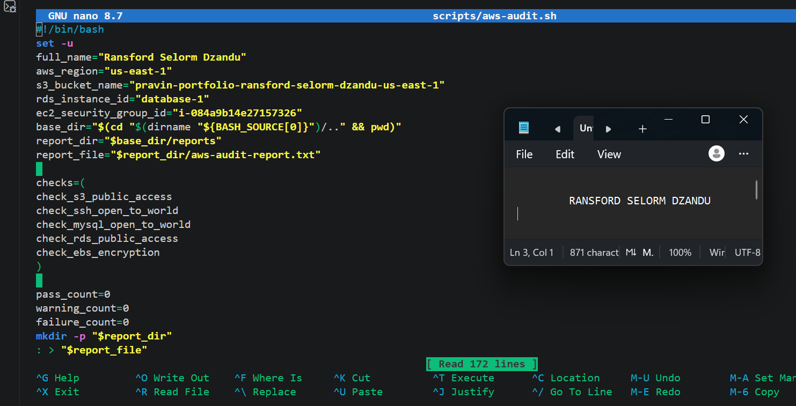

---

#### Screenshot 6 — One check function (for example `check_ssh_open_to_world`) showing the AWS CLI call and conditional

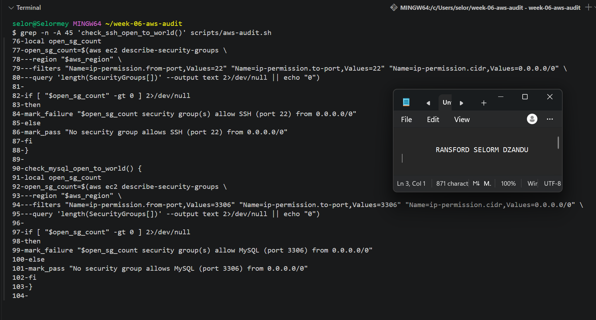
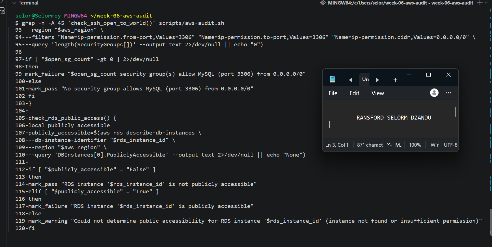

---

#### Screenshot 7 — Output of `bash -n scripts/aws-audit.sh` and `ls -l scripts/aws-audit.sh`

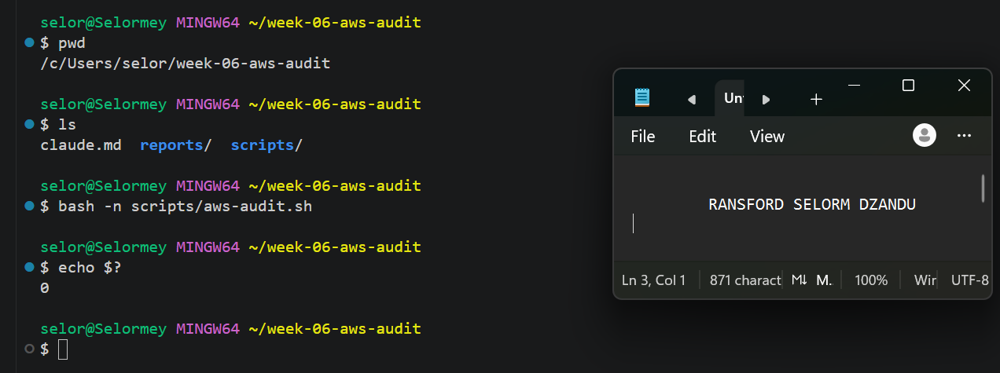

---

### Notes You Must Write (Very Important)

**1. What is stored in the checks array, and how does the loop use it?**

The checks array stores the names of the five audit functions:

- check_s3_public_access
- check_ssh_open_to_world
- check_mysql_open_to_world
- check_rds_public_access
- check_ebs_encryption

The loop goes through the array and executes each function automatically. This makes the script organized and allows all security checks to run in sequence.

**2. Why does every AWS CLI call in this script use `--query` and `--output text` instead of parsing raw JSON?**

The `--query` option extracts specific information from AWS CLI responses, while `--output text` displays the results in a simple format.

This makes it easier for Bash to compare values using conditional statements without processing large JSON responses.

**3. Why does the script use different exit codes for HEALTHY, WARN, and FAIL?**

Different exit codes make it easier to identify the overall audit result.

- Exit code `0` indicates HEALTHY.
- Exit code `1` indicates WARN.
- Exit code `2` indicates FAIL.

This allows users and automated systems to understand the result without manually reading the entire report.

---

# Task 5 — Run the Baseline Audit

## Goal

Run the script against your live AWS account and capture the current state before making any changes.

### Evidence

#### Screenshot 8 — Output of `./scripts/aws-audit.sh` showing your Full Name and all five checks

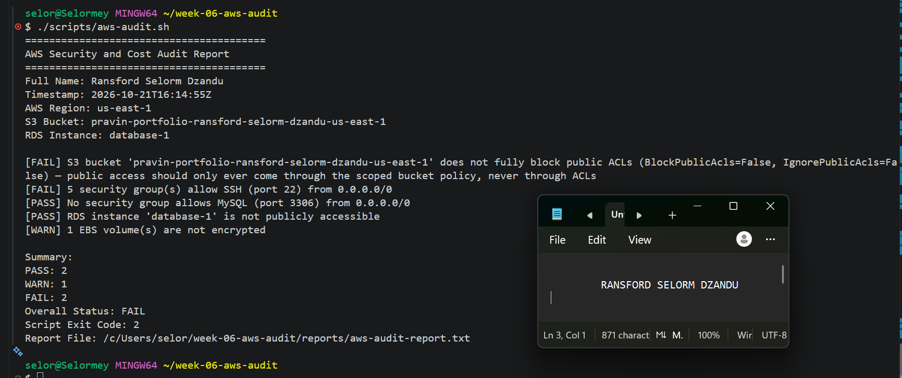

---

#### Screenshot 9 — Output showing the captured exit code and final summary

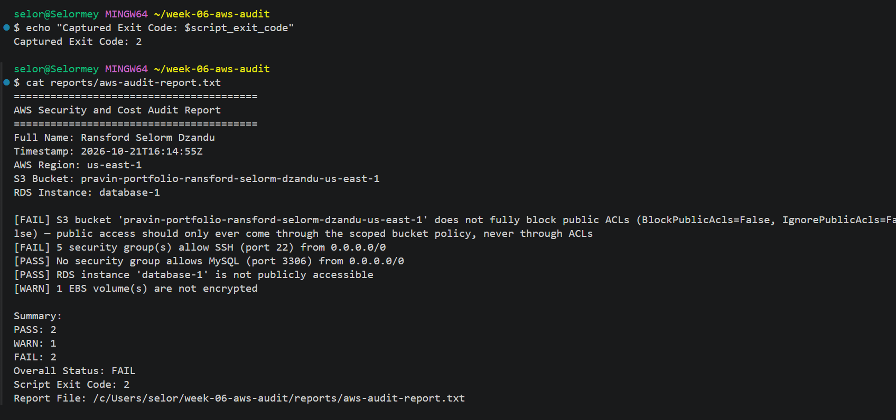

---

### Notes You Must Write (Very Important)

**1. What is the overall status of your baseline audit?**

My baseline audit returned an overall status of FAIL, with two PASS results, one WARN, and two FAIL results.

**2. Did any check return FAIL or WARN? If so, which one, and what evidence did it show?**

Yes. One confirmed failure involved my S3 bucket, where the audit detected that public ACL protections were not fully enabled.

The report showed:

BlockPublicAcls=False

IgnorePublicAcls=False

This indicated that the bucket did not fully block public access through ACLs.

The baseline audit also reported another FAIL and one WARN. Their exact findings should be documented using the evidence in the saved audit report.

**3. If every check passed, what does that tell you about the security posture of your account so far?**

If every check passed, it would indicate that the AWS resources met the five security conditions tested by the script. However, this would not guarantee complete AWS account security because the script checks only a limited number of configurations.

---

# Task 6 — Build and Run the /aws-audit Skill

## Goal

Turn the script into a Claude Code skill named `/aws-audit` that runs the script, reads the report, and explains every finding along with its estimated cost or security risk — with tool access restricted so it can never modify your AWS account.

### Evidence

#### Screenshot 10 — `SKILL.md` showing the frontmatter, tool restrictions, and safety rules

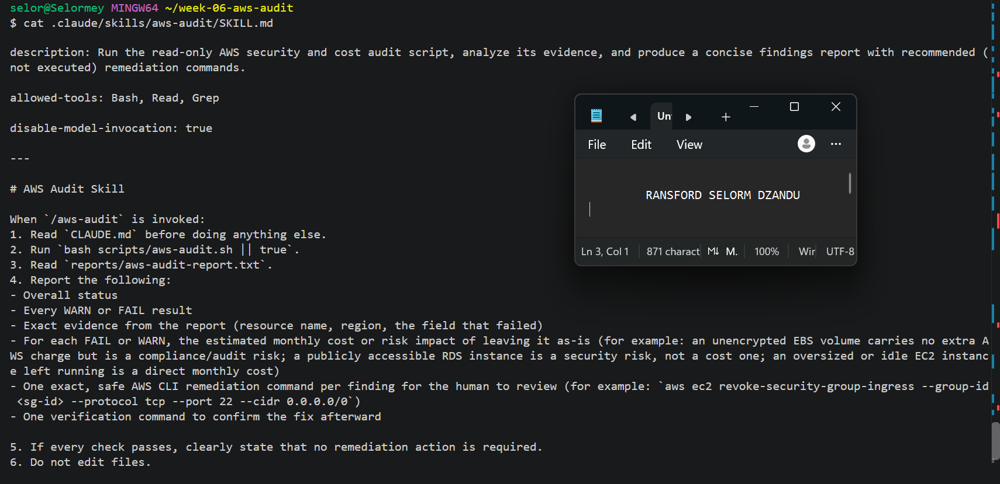

---

#### Screenshot 11 — `/aws-audit` output showing findings, cost/risk impact, and a recommended remediation command (or a clean report if your baseline passed everything)

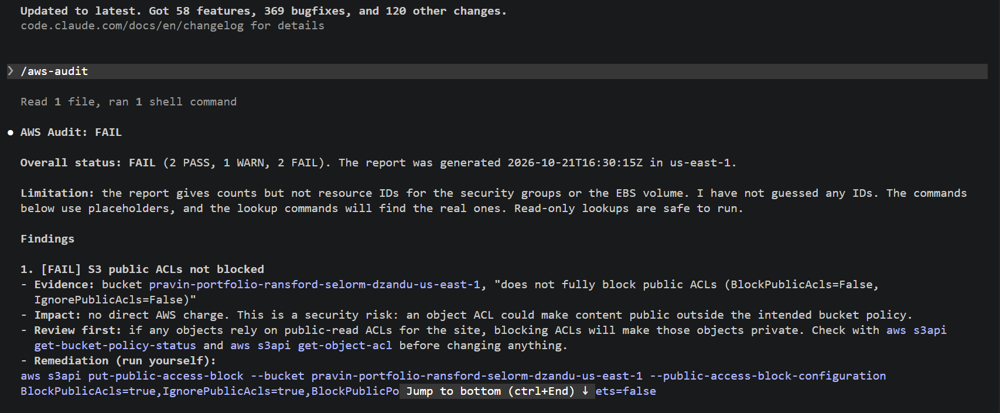

---

### Notes You Must Write (Very Important)

**1. Why does this skill have Bash, Read, and Grep, but not Write?**

The skill uses Bash to run the audit script, Read to examine the generated report, and Grep to search for relevant information.
Write permission is excluded because the skill is intended only to analyze existing evidence. It should not modify project files or AWS resources.

**2. What part is performed by Bash, and what part is performed by Claude?**

Bash performs the AWS security checks using read-only AWS CLI commands and generates a report containing PASS, WARN, and FAIL results.
Claude reads the report, explains the findings, identifies possible security and cost implications, and recommends remediation commands for human review.

**3. Why is estimating cost/risk impact something the AI adds on top of a plain PASS/FAIL script?**

A Bash script identifies whether a security condition passes or fails, but it does not necessarily explain the consequences.
Claude adds context by describing how a finding could affect security, availability, or AWS costs. This helps the engineer understand which issues need attention and why.

---

# Task 7 — Fix a Real Finding and Re-Verify

## Goal

Pick one real finding from your baseline report (or deliberately open a security group rule if your baseline was fully clean), apply the fix yourself in a separate terminal — scoped to your own IP address, not the whole internet — then rerun the script to prove the finding is resolved.

### Evidence

#### Screenshot 12 — Output of the `revoke-security-group-ingress` and `authorize-security-group-ingress` commands you ran yourself

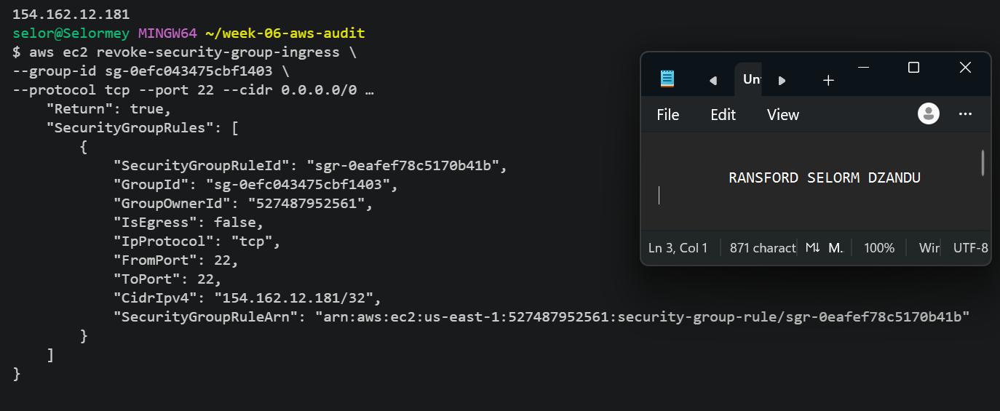

---

#### Screenshot 13 — Rerun of `./scripts/aws-audit.sh` showing the finding is now PASS

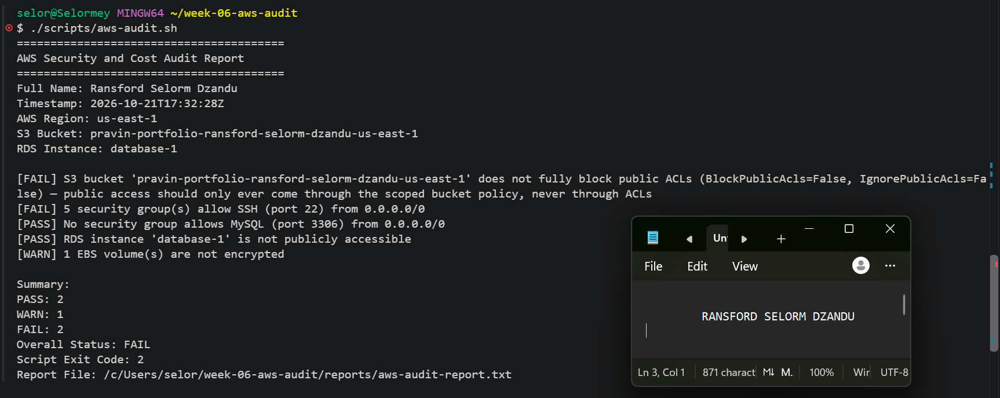

---

### Notes You Must Write (Very Important)

**1. Which exact finding did you fix, and what command did you run?**

**1. Which exact finding did you fix, and what command did you run?**

I fixed a security group misconfiguration that allowed SSH access on port 22 from anywhere on the internet 0.0.0.0/0. I used the AWS CLI revoke-security-group-ingress command to remove the unrestricted rule and authorize-security-group-ingress to allow SSH access only from my public IP address. After making the changes, I reran the AWS audit script to verify that the SSH security check passed.

**2. Why did you scope the new rule to your own IP address instead of leaving it open to `0.0.0.0/0`?**

Restricting SSH access to my own IP address reduces unnecessary exposure to the internet. Using `0.0.0.0/0` allows connection attempts from any IPv4 address, increasing the risk of unauthorized access attempts.

**3. Did Claude execute the remediation command, or did you? Why does that matter?**

The intended workflow requires me to review and execute the remediation command manually. Claude's responsibility is to analyze the findings and recommend a solution.
This separation is important because it prevents AI from making unapproved changes to live AWS infrastructure.

**4. Which phase of the Agentic Loop does the Bash script represent? Which phase does Claude's explanation represent? Which phase is you running the fix?**

The Bash script represents the **Gather** phase because it collects AWS configuration evidence.
Claude represents the **Analyze** phase because it interprets the audit results and recommends corrective actions.

Manually executing the remediation command represents the **Human Act** phase.
Running the audit script again represents the **Verify** phase because it confirms whether the security issue was resolved.

---

# LinkedIn Post (Required)

## Goal

Create a LinkedIn post including:

- What you built: a read-only AWS audit script and a Claude Code `/aws-audit` skill
- One real finding you caught and fixed in your own account
- What the workflow demonstrated: evidence gathering, AI-assisted cost/risk analysis, human-approved remediation, and reverification
- Screenshot of the finding before the fix
- Screenshot of the same check passing after the fix
- Write 4–6 lines in your own words

Suggested tags:

`#DMIByPravinMishra #AWS #AgenticAI #ClaudeCode #DevOps`

### Evidence

#### LinkedIn Post URL

Paste your LinkedIn post URL here:

https://www.linkedin.com/posts/ransfordselormdzandu_devopsabrengineering-cloudabrengineering-share-7518922500974723072-m2r_/?utm_source=share&utm_medium=member_desktop&rcm=ACoAAEwl7_QBxhr73Ja5tGLqw7xByGHiHbrAk08

---

#### Screenshot of Published LinkedIn Post

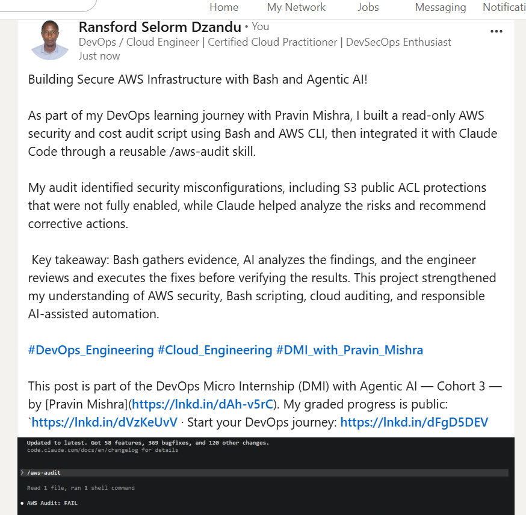

---

# Submission Instructions

Complete all tasks in sequence.

Your submission must include:

- All 13 required task screenshots
- Answers to every **Notes You Must Write** question
- `CLAUDE.md`
- `scripts/aws-audit.sh`
- `.claude/skills/aws-audit/SKILL.md`
- `reports/aws-audit-report.txt` baseline report and the reverified report from Task 7
- GitHub folder or repository URL containing the assignment files
- Your Full Name visible in the required outputs
- LinkedIn post URL
- Screenshot of the published LinkedIn post
- GitHub repository URL (containing all assignment files)

---

# Completion Checklist

- [ ] Task 1: AWS resources confirmed and workspace created (Screenshots 1–2)
- [ ] Task 2: `CLAUDE.md` created with project context and safety rules (Screenshot 3)
- [ ] Task 3: Claude produced a read-only five-check audit plan before any script existed (Screenshot 4)
- [ ] Task 4: `aws-audit.sh` built, executable, and passes `bash -n` (Screenshots 5–7)
- [ ] Task 5: Baseline audit captured and saved with Full Name visible (Screenshots 8–9)
- [ ] Task 6: `/aws-audit` skill loads and runs successfully with no Write permission (Screenshots 10–11)
- [ ] Task 7: A real finding was fixed by you and reverified as PASS (Screenshots 12–13)
- [ ] Skill never executed a remediation command
- [ ] New security group rule is scoped to your own IP, not `0.0.0.0/0`
- [ ] All 13 required task screenshots are included
- [ ] All "Notes You Must Write" questions are answered in your own words
- [ ] No AWS credentials or unblurred account IDs exposed
- [ ] LinkedIn post published and URL submitted
- [ ] GitHub repository URL included in submission
- [ ] All assignment files committed and visible in GitHub repository

---

# Final Submission

Submit your GitHub repository URL containing all assignment files, screenshots, reports, and output.

### GitHub Repository URL

Paste your GitHub repository URL here:

https://github.com/ransfordselormdzandu/devops-micro-internship-pravinmishra

---

## 📌 About DMI & CloudAdvisory

DevOps Micro Internship (DMI) is a project-based DevOps program run by Pravin Mishra (The CloudAdvisory) focused on real-world execution, systems thinking, and career readiness.

It helps learners build strong DevOps foundations with hands-on experience.

---

## 📌 Resources

- 🌐 DMI Official Website: https://dmi.pravinmishra.com?utm_source=github&utm_medium=readme  
- 🎓 University: https://university.pravinmishra.com?utm_source=github&utm_medium=readme  
- 💬 Discord Community: https://discord.pravinmishra.com?utm_source=github&utm_medium=readme  
- 📝 Blog: https://dmi.pravinmishra.com/blog?utm_source=github&utm_medium=readme  
- ▶️ YouTube Playlist: https://www.youtube.com/playlist?list=PLFeSNDtI4Cho  
- 🔗 Pravin Mishra (LinkedIn): https://www.linkedin.com/in/pravin-mishra-aws-trainer/  
- 🏢 CloudAdvisory (LinkedIn): https://www.linkedin.com/company/thecloudadvisory/

---

*This submission is part of DevOps Micro Internship (DMI) — Agentic AI Track.*