# Assignment 03 — Deploy a Static Website to Multiple Servers Using a Multi-Play Ansible Playbook

Part of the DevOps Micro Internship (DMI) with Agentic AI

---

## Student Details

**Full Name:** Add your full name here  
**Cloud Platform Used:** AWS / Azure  
**Server 1 URL:** `http://<SERVER_1_PUBLIC_IP>`  
**Server 2 URL:** `http://<SERVER_2_PUBLIC_IP>`

---

## Purpose

In this assignment, you will create a multi-play Ansible playbook to install Nginx, deploy a static website to two Ubuntu servers, and verify that the website is accessible from both servers.

You may use either AWS EC2 instances or Azure Virtual Machines as your managed servers.

---

# Task 1 — Create the Project Structure

## Goal

Create the required folders and files for the Ansible project.

## Evidence

### Screenshot 1 — Terminal or VS Code showing the complete `static-web` project structure

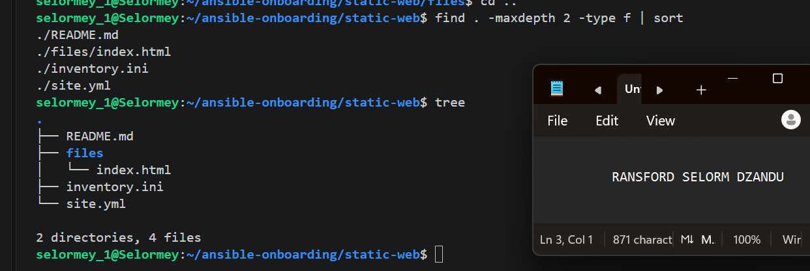

---

# Task 2 — Configure the Ansible Inventory

## Goal

Add both Ubuntu servers to the Ansible inventory.

## Evidence

### Screenshot 2 — Output of `ansible-inventory -i inventory.ini --graph` showing `web1` and `web2`

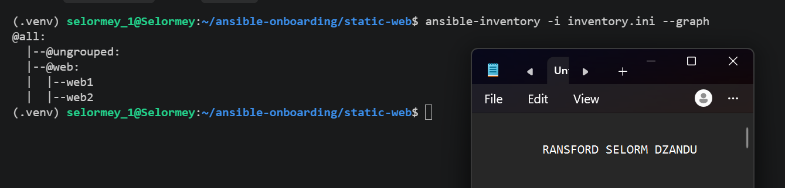

---

## Configuration File

Copy and paste the complete contents of your `inventory.ini` file below:

```ini
 [web]
 2 web1 ansible_host=18.207.148.52
 3 web2 ansible_host=32.200.122.199
 4
 5 [web:vars]
 6 ansible_user=ubuntu
 7 ansible_ssh_private_key_file=/home/selormey_1/.ssh/id_ed25519
 8
```

---

# Task 3 — Verify Ansible Connectivity

## Goal

Confirm that the Ansible controller can connect to both servers.

## Evidence

### Screenshot 3 — Ansible ping output showing `SUCCESS` and `pong` for both servers

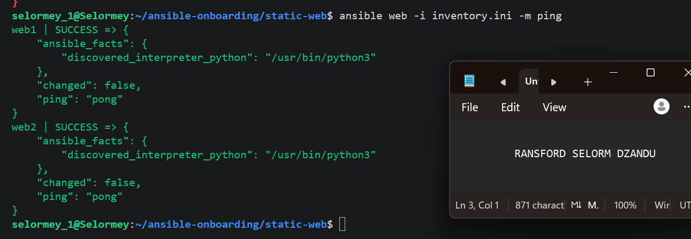

---

# Task 4 — Download and Personalize the Static Website

## Goal

Download `index.html` to the Ansible controller and personalize the website with your full name.

## Evidence

### Screenshot 4 — Edited `files/index.html` showing the footer line with your full name

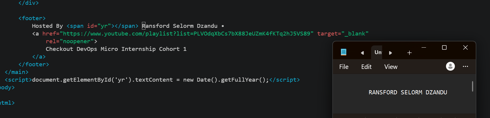

---

# Task 5 — Create the Multi-Play Ansible Playbook

## Goal

Create a single Ansible playbook containing separate plays for installation, deployment, and verification.

## Configuration File

Copy and paste the complete contents of your `site.yml` file below:

```yaml
- name: Install and configure Nginx on web servers
 3   hosts: web
 4   become: true
 5
 6   tasks:
 7     - name: Update APT package cache
 8       ansible.builtin.apt:
 9         update_cache: true
10
11     - name: Install Nginx
12       ansible.builtin.apt:
13         name: nginx
14         state: present
15
16     - name: Start and enable Nginx
17       ansible.builtin.service:
18         name: nginx
19         state: started
           enabled: true


- name: Deploy static website to web servers
26   hosts: web
27   become: true
28
29   tasks:
30     - name: Copy static website to Nginx document root
31       ansible.builtin.copy:
32         src: files/index.html
33         dest: /var/www/html/index.html
34         owner: www-data
35         group: www-data
36         mode: "0644"
37       notify: Reload Nginx
38
39   handlers:
40     - name: Reload Nginx
41       ansible.builtin.service:
42         name: nginx
           state: reloaded


  - name: Verify both websites from the Ansible controller
48   hosts: localhost
49   connection: local
50   gather_facts: false
51   become: false
52
53   tasks:
54     - name: Check HTTP response from each web server
55       ansible.builtin.uri:
56         url: "http://{{ hostvars[item].ansible_host }}"
57         method: GET
58         status_code: 200
59       loop: "{{ groups['web'] }}"
60       register: website_checks
61
62     - name: Assert each website returned HTTP 200
63       ansible.builtin.assert:
64         that: 
             - item.status == 200
66         success_msg: "{{ item.item }} returned HTTP {{ item.status }} - SUCCESS"
67         fail_msg: "{{ item.item }} returned an unexpected HTTP status"
68       loop: "{{ website_checks.results }}"
69       loop_control:
70         label: "{{ item.item }}"         
```

---

# Task 6 — Validate the Playbook Syntax

## Goal

Check the playbook for YAML or Ansible syntax errors before running it.

## Evidence

### Screenshot 5 — Successful syntax-check output showing `playbook: site.yml`

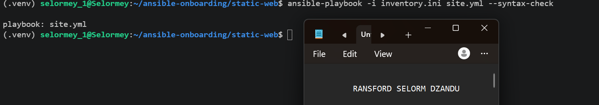

---

# Task 7 — Run the Multi-Play Playbook

## Goal

Install Nginx, deploy the website, and verify both servers in one playbook run.

## Evidence

### Screenshot 6 — Play 3 verification showing HTTP `200` for both servers

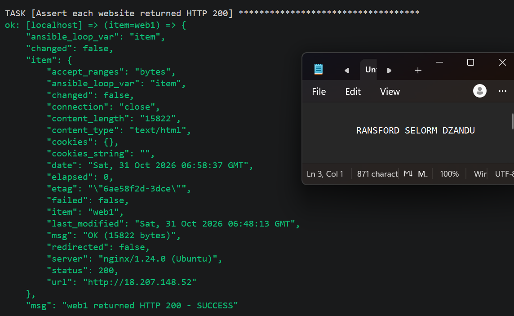
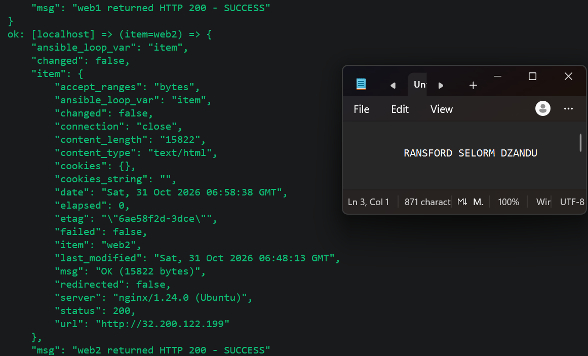

---

### Screenshot 7 — Final play recap showing `unreachable=0` and `failed=0` for `web1`, `web2`, and `localhost`

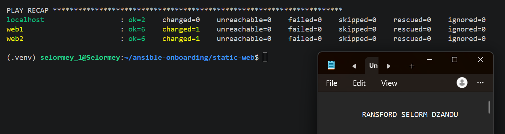

---

# Task 8 — Verify Idempotency

## Goal

Run the playbook again and confirm that it does not make unnecessary changes.

## Evidence

### Screenshot 8 — Second playbook run showing the play recap with `changed=0`, `unreachable=0`, and `failed=0` for both web servers

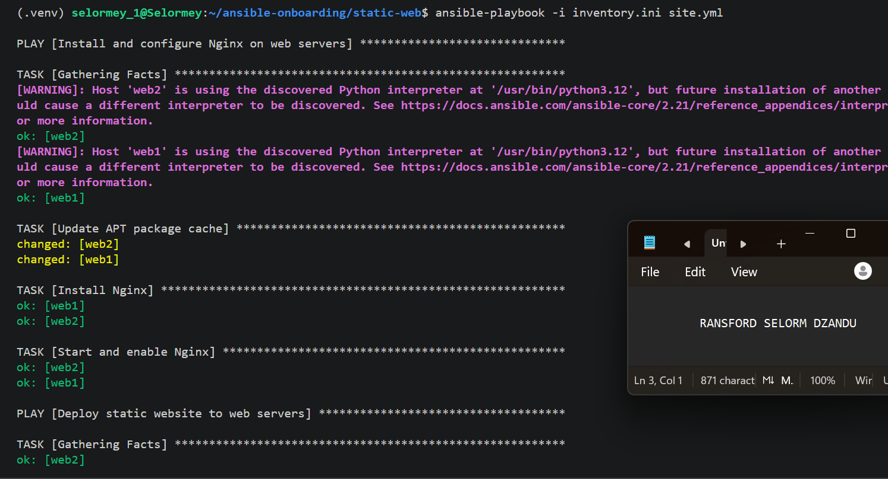

---

# Task 9 — Test Both Websites Manually

## Goal

Confirm that the static website is accessible from both public IP addresses.

## Evidence

### Screenshot 9 — `curl -I` output showing HTTP `200 OK` from both servers

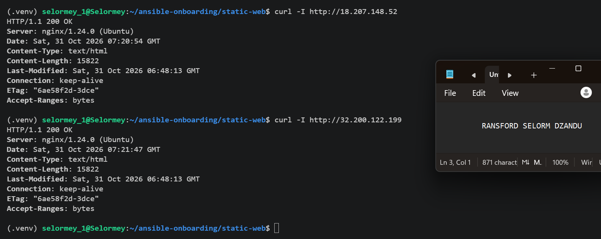

---

### Screenshot 10 — Browser showing the website from Server 1 with the public IP and your full name visible

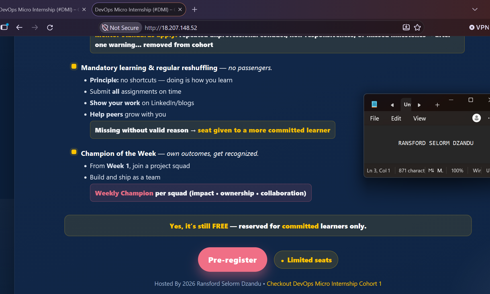

---

### Screenshot 11 — Browser showing the website from Server 2 with the public IP and your full name visible


---

## Website URLs

Add both deployed website URLs below:

```text
Server 1: http://18.207.148.52
Server 2: http://32.200.122.199
```

---

# Task 10 — Complete the Project README

## Goal

Document how the project works and record what you learned.

## README Content

Copy and paste the complete contents of your `README.md` file below:

```markdown
# Multi-Play Ansible Static Website Deployment

## Project Overview

This project demonstrates how to automate the installation, deployment, and verification of a static website using Ansible.

I used Terraform to provision AWS EC2 instances and Ansible to configure two Ubuntu web servers named `web1` and `web2`.

I created an Ansible playbook named `site.yml` containing three plays:

1. **Install and Configure Nginx:** Update the APT package cache, install Nginx, and ensure the service is started and enabled.
2. **Deploy the Static Website:** Copy `files/index.html` from the Ansible controller to `/var/www/html/index.html` on both web servers. A handler reloads Nginx when the website file changes.
3. **Verify Both Websites:** Send HTTP GET requests from the Ansible controller to both servers and verify that each returns HTTP status code `200`.

The objective was to deploy the same website consistently across multiple servers using automation instead of manually configuring each server.

## Environment

- **Cloud platform:** Amazon Web Services (AWS)
- **AWS region:** us-east-1 (Northern Virginia)
- **Operating system:** Ubuntu 24.04 LTS
- **Ansible controller:** Local Ubuntu workstation
- **Number of managed servers:** 2 web servers (`web1` and `web2`)
- **Web server:** Nginx
- **Infrastructure provisioning:** Terraform
- **Configuration management:** Ansible
- **Connection method:** SSH using an ED25519 key pair

## How to Run the Playbook

First, navigate to the project directory:

```bash
cd ~/ansible-onboarding/static-web
```

Activate the Python virtual environment:

```bash
source ~/ansible-onboarding/.venv/bin/activate
```

Verify connectivity to the web servers:

```bash
ansible web -i inventory.ini -m ping
```

Check the playbook syntax:

```bash
ansible-playbook -i inventory.ini site.yml --syntax-check
```

Execute the complete playbook:

```bash
ansible-playbook -i inventory.ini site.yml
```

The playbook installs and configures Nginx, deploys the website to both servers, and verifies the HTTP responses.

## Issue Faced and Solution

One issue I encountered was an SSH connection timeout when attempting to connect to my AWS EC2 instances using Ansible.

The error message was:

```text
Failed to connect to the host via ssh:
connect to host port 22: Connection timed out
```

The troubleshooting involved checking my controller's public IP address, reviewing the AWS Security Group rules, and confirming that the EC2 public IP addresses matched those in my Ansible inventory.

Because SSH access was restricted to the controller's public IP using `/32`, a change in my public IP could prevent Ansible from connecting.

I learned to verify the controller's current public IP and update the Terraform Security Group configuration when necessary.

I also encountered a Terraform deployment error because the selected EC2 instance type was unsupported in the initially selected Availability Zone. I addressed this by configuring a supported Availability Zone.

## What I Learned

This assignment helped me understand how Ansible can automate repetitive configuration tasks across multiple servers.

I learned how to:

- Use Terraform to provision AWS infrastructure.
- Organize managed servers into inventory groups.
- Connect to EC2 instances securely using SSH.
- Write YAML playbooks containing multiple plays.
- Use fully qualified Ansible module names.
- Install packages and manage services using Ansible.
- Deploy website files with the `ansible.builtin.copy` module.
- Use handlers to reload services only when changes occur.
- Verify website availability using `ansible.builtin.uri` and `ansible.builtin.assert`.

I also gained a better understanding of idempotency, where running the same playbook repeatedly should not cause unnecessary changes when the desired configuration is already in place.

## Why Installation and Deployment Are Separate

Installing Nginx and deploying website content are handled in separate plays because they perform different responsibilities.

The first play prepares the servers by installing and starting Nginx, while the second play deploys the website files.

Separating these activities makes the playbook easier to understand, maintain, troubleshoot, and update.

For example, I can update the website content without changing the Nginx installation tasks.

This approach also makes the automation more organized and reusable.

## Benefit of the Ansible Copy Module

One benefit of using the `ansible.builtin.copy` module instead of cloning the website directly from Git on every managed server is **consistency**.

The `copy` module transfers the same website file from the Ansible controller to each managed server, ensuring that both web servers receive the intended content.

It also eliminates the need to install Git or configure repository access on every managed server.

Additionally, Ansible detects changes to the file, allowing the Nginx reload handler to run only when necessary.
```

---

# LinkedIn Post Required

## Evidence

### LinkedIn Post URL

Paste your LinkedIn post URL here:

https://www.linkedin.com/posts/ransfordselormdzandu_devopsabrengineering-cloudabrengineering-share-7522217256219742208-Iqij/?utm_source=share&utm_medium=member_desktop&rcm=ACoAAEwl7_QBxhr73Ja5tGLqw7xByGHiHbrAk08

---

### Screenshot — Published LinkedIn post

devops-micro-internship-pravinmishra/week-09-ansible/screenshots/03_linkedin_screenshots_1.png
devops-micro-internship-pravinmishra/week-09-ansible/screenshots/03_linkedin_sreenshot_02.png

---

# Assignment Questions

Answer the following in your own words:

**1. What issue did you face while completing this assignment, and how did you fix it?**

One issue I faced during the assignment was an SSH connection timeout when Ansible attempted to connect to my AWS EC2 instances. I troubleshot the issue by checking my controller's public IP address, reviewing the AWS Security Group rules, and verifying the IP addresses in my Ansible inventory.

I also encountered an error when Terraform tried to launch t3.micro instances in an unsupported Availability Zone. I fixed this by configuring the subnet to use a supported Availability Zone us-east-1a.

These challenges helped me better understand AWS networking, Security Groups, SSH connectivity, and troubleshooting infrastructure deployments.

---

**2. What did you learn from this assignment?**

From this assignment, I learned how to use Ansible to automate the configuration and deployment of a static website across multiple AWS EC2 instances.

I gained hands-on experience writing multi-play Ansible playbooks, managing inventory groups, installing and configuring Nginx, deploying website files using the `copy` module, and using handlers to reload services only when changes occur.

I also learned how to verify website availability using the `uri` and `assert` modules, as well as the importance of idempotency, automation, and troubleshooting SSH connectivity.

Overall, this assignment strengthened my understanding of Infrastructure as Code (IaC), configuration management, and consistent, repeatable deployments in DevOps.

---

**3. Why is it useful to split installation, deployment, and verification into separate plays?**

Splitting installation, deployment, and verification into separate plays makes the Ansible playbook more organized, easier to maintain, and simpler to troubleshoot.

Each play has a specific responsibility: the first installs and configures Nginx, the second deploys the website files, and the third verifies that both web servers return HTTP status code `200`.

This separation makes it easier to identify errors, update website content without modifying the installation process, and ensure that each stage works correctly.

Overall, it improves reusability, consistency, and reliability in automated deployments.

---

**4. What is one benefit of using the Ansible `copy` module instead of cloning the website directly from Git on every managed server?**

One benefit of using the Ansible `copy` module is consistency across multiple servers. It allows me to deploy the same website files directly from the Ansible controller to all managed servers, ensuring they have identical content.

It also eliminates the need to install Git or clone the repository on each server, making deployment simpler, faster, and easier to manage.

---

**5. What does idempotency mean in this assignment?**

Idempotency in this assignment means that running the same Ansible playbook multiple times produces the same desired result without making unnecessary changes.

For example, once Nginx is installed and the static website is deployed, running the playbook again will not reinstall Nginx or copy unchanged website files. The Nginx reload handler will only run when the website file changes.

This makes the deployment process consistent, efficient, and reliable, while reducing unnecessary operations on the managed servers.

---

**6. What does the Ansible `uri` module verify in Play 3?**

In Play 3, the Ansible `uri` module verifies that both web servers are accessible and successfully serving the deployed static website.

It sends HTTP GET requests from the Ansible controller to each server's public IP address and checks whether the response returns HTTP status code 200 (OK).

This helps confirm that Nginx is running, the website is reachable, and the deployment is responding successfully on both servers.

---

# Required Files

Confirm that the following files are included in your assignment folder:

- [ ] `inventory.ini`
- [ ] `site.yml`
- [ ] `files/index.html`
- [ ] `README.md`

---

# Submission Instructions

- Add all required screenshots in the correct order.
- Full Name must be visible in required screenshots.
- Include both deployed website URLs.
- Paste `inventory.ini`, `site.yml`, and `README.md` as editable text.
- Answer all assignment questions clearly in your own words.
- Add your LinkedIn post URL.
- Do not expose SSH private keys, passwords, cloud account IDs, or other sensitive information.

---

# Completion Checklist

- [ ] Task 1: `static-web` folder structure is complete
- [ ] Task 2: Both servers are listed under the `[web]` group in `inventory.ini`
- [ ] Task 2: Inventory graph shows `web1` and `web2`
- [ ] Task 3: Ansible ping returns `SUCCESS` and `pong` for both servers
- [ ] Task 4: `files/index.html` contains your full name
- [ ] Task 5: `site.yml` contains three separate plays
- [ ] Task 5: Play 1 installs, starts, and enables Nginx
- [ ] Task 5: Play 2 deploys `index.html` using the `copy` module
- [ ] Task 5: Nginx reload handler is included
- [ ] Task 5: Play 3 verifies both web servers from the controller
- [ ] Task 6: Playbook syntax check passes
- [ ] Task 7: First playbook run completes with `unreachable=0` and `failed=0`
- [ ] Task 7: URI verification returns HTTP `200` for both servers
- [ ] Task 8: Second playbook run demonstrates idempotency
- [ ] Task 8: Second run shows `changed=0` for both web servers
- [ ] Task 9: Both `curl -I` commands return HTTP `200 OK`
- [ ] Task 9: Website loads from Server 1
- [ ] Task 9: Website loads from Server 2
- [ ] Task 9: Full name is visible on both deployed websites
- [ ] Task 10: `README.md` contains all required explanations
- [ ] Screenshots 1–11 are included
- [ ] `inventory.ini`, `site.yml`, and `README.md` are pasted as editable text
- [ ] Both website URLs are included
- [ ] Assignment questions are answered
- [ ] LinkedIn post published
- [ ] LinkedIn post URL added
- [ ] No sensitive information is exposed

---

## About DMI & CloudAdvisory

DevOps Micro Internship (DMI) is a project-based DevOps program run by Pravin Mishra and The CloudAdvisory, focused on real-world execution, systems thinking, and career readiness.

It helps learners build strong DevOps foundations with hands-on experience.

---

## Resources

- DMI Official Website: [https://dmi.pravinmishra.com?utm_source=github&utm_medium=readme](https://dmi.pravinmishra.com?utm_source=github&utm_medium=readme)
- University: [https://university.pravinmishra.com?utm_source=github&utm_medium=readme](https://university.pravinmishra.com?utm_source=github&utm_medium=readme)
- Discord Community: [https://discord.pravinmishra.com?utm_source=github&utm_medium=readme](https://discord.pravinmishra.com?utm_source=github&utm_medium=readme)
- Blog: [https://dmi.pravinmishra.com/blog?utm_source=github&utm_medium=readme](https://dmi.pravinmishra.com/blog?utm_source=github&utm_medium=readme)
- YouTube Playlist: [https://www.youtube.com/playlist?list=PLFeSNDtI4Cho](https://www.youtube.com/playlist?list=PLFeSNDtI4Cho)
- Pravin Mishra LinkedIn: [https://www.linkedin.com/in/pravin-mishra-aws-trainer/](https://www.linkedin.com/in/pravin-mishra-aws-trainer/)
- CloudAdvisory LinkedIn: [https://www.linkedin.com/company/thecloudadvisory/](https://www.linkedin.com/company/thecloudadvisory/)

---

*This submission is part of DevOps Micro Internship (DMI) — Agentic AI Track.*