# Assignment 04 — Deploy Mini Finance on Azure Using Terraform and Ansible

Part of the DevOps Micro Internship (DMI) with Agentic AI

---

## Purpose

In this assignment, you will provision Azure infrastructure using Terraform and deploy the Mini Finance website using an Ansible multi-play playbook.

Terraform will create the Azure Virtual Machine and networking resources. Ansible will install Nginx, clone the Mini Finance repository, deploy the website, and verify the deployment.

---

# Task 1 — Create the Project Structure

## Goal

Create separate directories and files for the Terraform infrastructure and Ansible configuration.

### Evidence

#### Screenshot 1 — Terminal or VS Code showing the complete `mini-finance` project structure

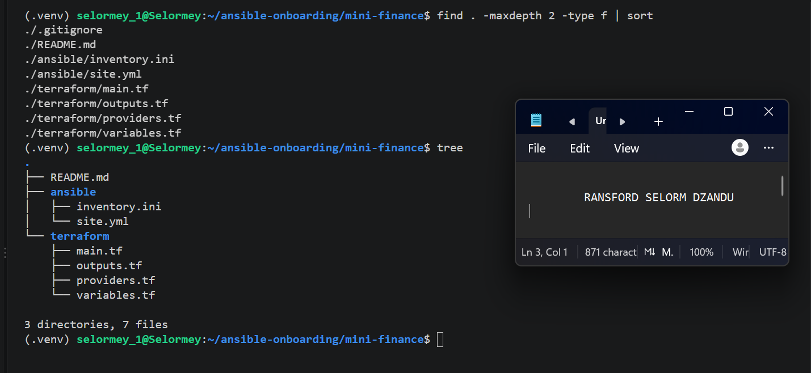

---

### Notes


---

# Task 2 — Create the Azure Infrastructure Using Terraform

## Goal

Use Terraform to provision an Ubuntu Virtual Machine with the required Azure networking and security resources.

### Evidence

#### Screenshot 2 — Terraform code showing the `Allow-SSH` rule for port `22` and the `Allow-HTTP` rule for port `80`

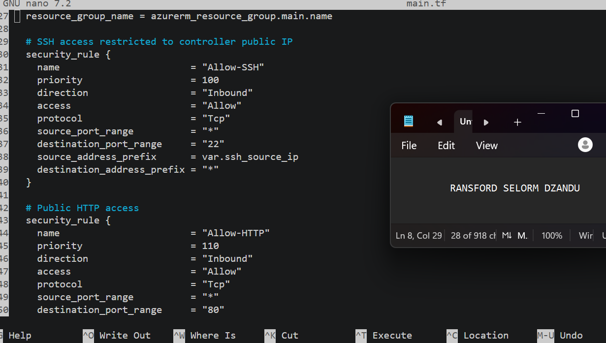

---

#### Screenshot 3 — Terraform code showing the association between `nsg-mini-finance` and `nic-mini-finance`

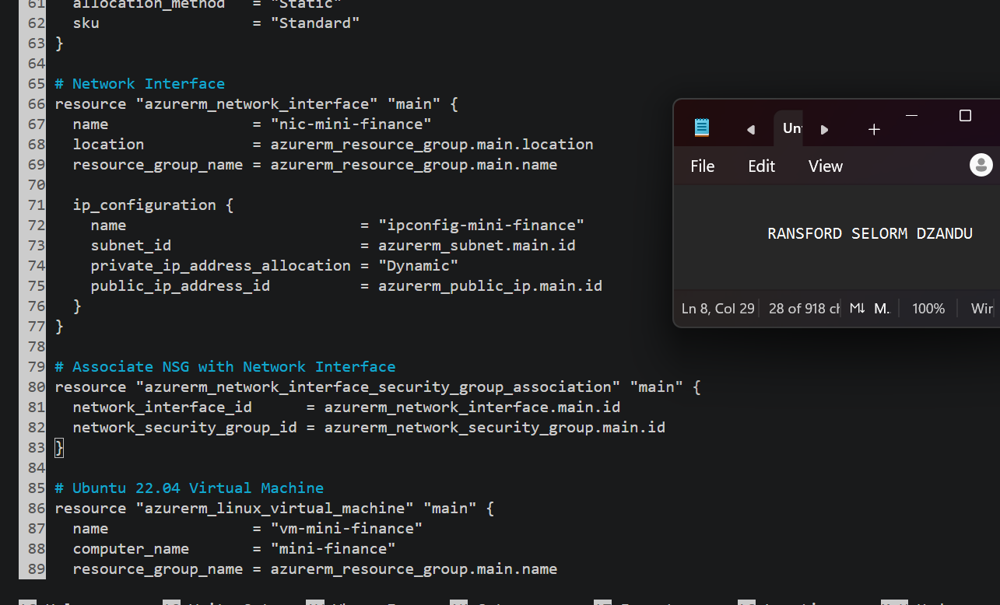

---

### Notes


---

# Task 3 — Initialize and Apply the Terraform Configuration

## Goal

Format and validate the Terraform configuration, review the execution plan, and provision the Azure infrastructure.

### Evidence

#### Screenshot 4 — End of the `terraform apply` output showing `Apply complete!` with no errors

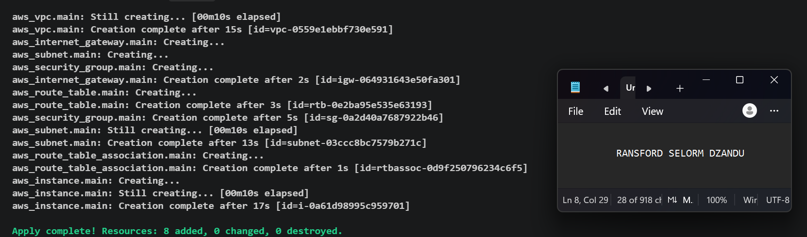

---

#### Screenshot 5 — Output of `terraform output public_ip` showing the VM’s public IP address

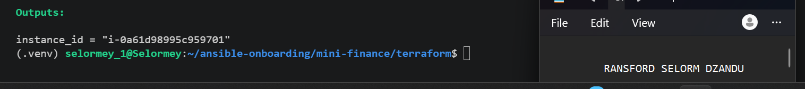

---

### Notes


---

# Task 4 — Verify Passwordless SSH Access

## Goal

Confirm that the Ansible controller can connect to the Terraform-provisioned Azure VM using SSH key authentication.

### Evidence

#### Screenshot 6 — Passwordless SSH command and the returned `mini-finance` hostname

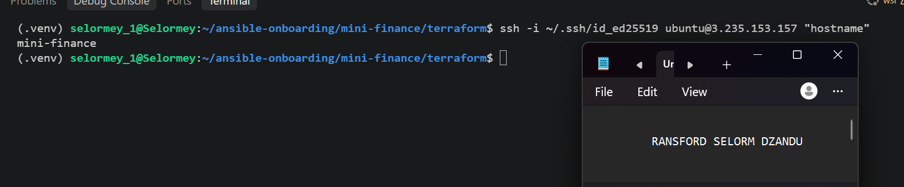

---

### Notes


---

# Task 5 — Create the Ansible Inventory and Verify Connectivity

## Goal

Add the Terraform-provisioned Azure VM to the Ansible inventory and confirm that Ansible can connect to it.

### Evidence

#### Screenshot 7 — Ansible ping output showing `SUCCESS` and `pong` from the Azure VM

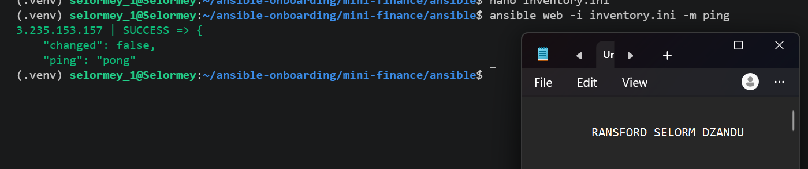

---

### Configuration File

Copy and paste the complete contents of your `ansible/inventory.ini` file below:

```ini
[web]
3.235.153.157

[web:vars]
ansible_user=ubuntu
ansible_ssh_private_key_file=~/.ssh/id_ed25519
ansible_python_interpreter=/usr/bin/python3
```

---

# Task 6 — Create the Multi-Play Ansible Playbook

## Goal

Create one Ansible playbook containing separate plays to install Nginx, deploy the Mini Finance website, and verify the deployment.

### Evidence

#### Screenshot 8 — `site.yml` showing Play 1 and the beginning of Play 2

Screenshot must show:

- Play 1 targeting the `web` group
- Installation of `nginx`, `git`, and `rsync`
- Nginx service configured as started and enabled
- Beginning of Play 2 with the Git repository URL and synchronization task

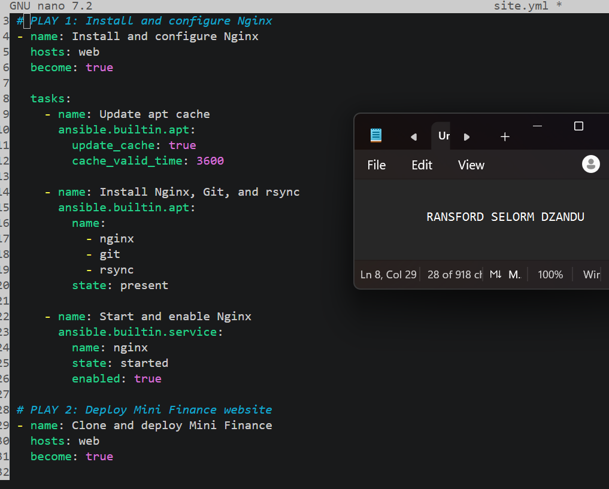

---

#### Screenshot 9 — `site.yml` showing the deployment destination, handler, and Play 3 verification

Screenshot must show:

- Website destination `/var/www/html/`
- Ownership set to `www-data:www-data`
- Nginx reload handler
- Play 3 targeting `localhost`
- The `uri` verification and `assert` condition

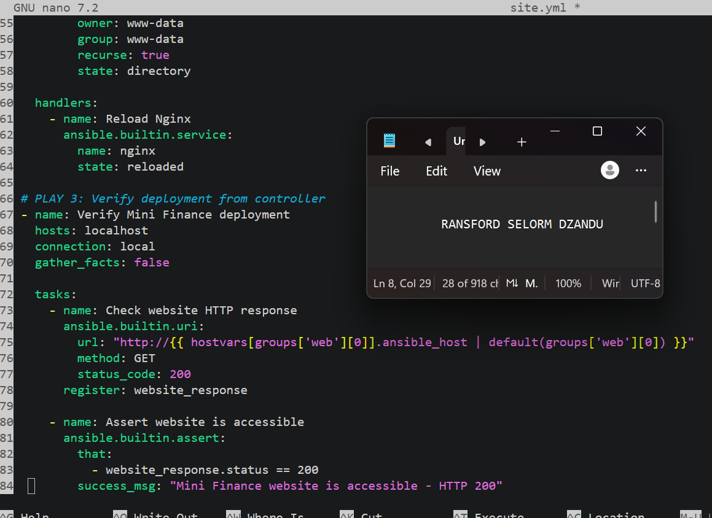

---

### Configuration File

Copy and paste the complete contents of your `ansible/site.yml` file below:

```yaml
---
 2 # PLAY 1: Install and configure Nginx
 3 - name: Install and configure Nginx
 4   hosts: web
 5   become: true
 6
 7   tasks:
 8     - name: Update apt cache
 9       ansible.builtin.apt:
10         update_cache: true
11         cache_valid_time: 3600
12
13     - name: Install Nginx, Git, and rsync
14       ansible.builtin.apt:
15         name:
16           - nginx
17           - git
18           - rsync
19         state: present
20
21     - name: Start and enable Nginx
22       ansible.builtin.service:
23         name: nginx
24         state: started
25         enabled: true
26
27 # PLAY 2: Deploy Mini Finance website
28 - name: Clone and deploy Mini Finance
29   hosts: web
30   become: true
31
32   tasks:
33     - name: Clone Mini Finance repository
34       ansible.builtin.git:
35         repo: https://github.com/pravinmishraaws/mini-finance-project
36         dest: /opt/mini-finance
37         version: HEAD
38         update: true
39
40     - name: Synchronize website files
41       ansible.posix.synchronize:
42         src: /opt/mini-finance/
43         dest: /var/www/html/
44         recursive: true
45         delete: true
46         rsync_opts:
47           - "--exclude=.git"
48       delegate_to: "{{ inventory_hostname }}"
49       notify: Reload Nginx
50
51     - name: Set website ownership
  ansible.builtin.file:
53         path: /var/www/html/
54         owner: www-data
55         group: www-data
56         recurse: true
57         state: directory
58
59   handlers:
60     - name: Reload Nginx
61       ansible.builtin.service:
62         name: nginx
63         state: reloaded
64
65 # PLAY 3: Verify deployment from controller
66 - name: Verify Mini Finance deployment
67   hosts: localhost
68   connection: local
69   gather_facts: false
70
71   tasks:
72     - name: Check website HTTP response
73       ansible.builtin.uri:
74         url: "http://{{ hostvars[groups['web'][0]].ansible_host | default(groups['web'][0]) }}"
75         method: GET
76         status_code: 200
77       register: website_response
78
79     - name: Assert website is accessible
80            ansible.builtin.assert:
81         that:
82           - website_response.status == 200
83         success_msg: "Mini Finance website is accessible - HTTP 200"
84
```

---

# Task 7 — Validate and Run the Ansible Playbook

## Goal

Validate the syntax of the multi-play Ansible playbook and run it to install Nginx, deploy the Mini Finance website, and verify the deployment.

### Evidence

#### Screenshot 10 — Successful playbook syntax check showing `playbook: site.yml`

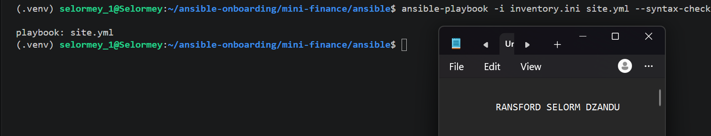

---

#### Screenshot 11 — Play 3 output showing the successful HTTP verification and assertion

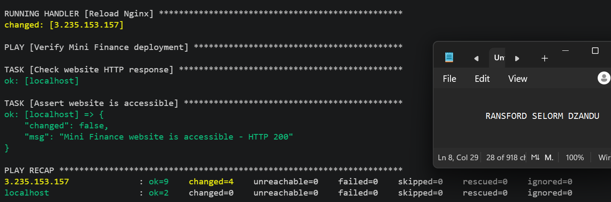

---

#### Screenshot 12 — Final `PLAY RECAP` showing `failed=0` and `unreachable=0`

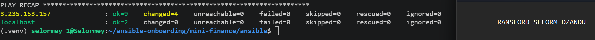

---

### Notes


---

# Task 8 — Test the Mini Finance Website in a Browser

## Goal

Confirm that the Mini Finance website is publicly accessible through the Azure VM’s public IP address.

### Evidence

#### Screenshot 13 — Mini Finance website successfully loading in the browser, with the Azure VM’s public IP address visible in the address bar

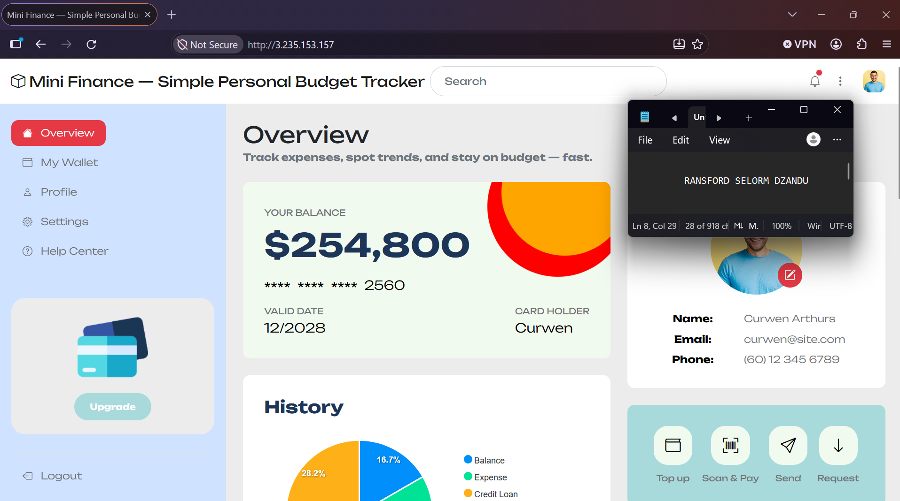

---

### Website URL

Add your deployed website URL below:

```text
http://3.235.153.157
```

---

# Task 9 — Create the Project README

## Goal

Create a `README.md` file to document the Mini Finance infrastructure and deployment project.

### Evidence

#### Screenshot 14 — Completed `README.md` displayed in the VS Code Markdown preview or terminal

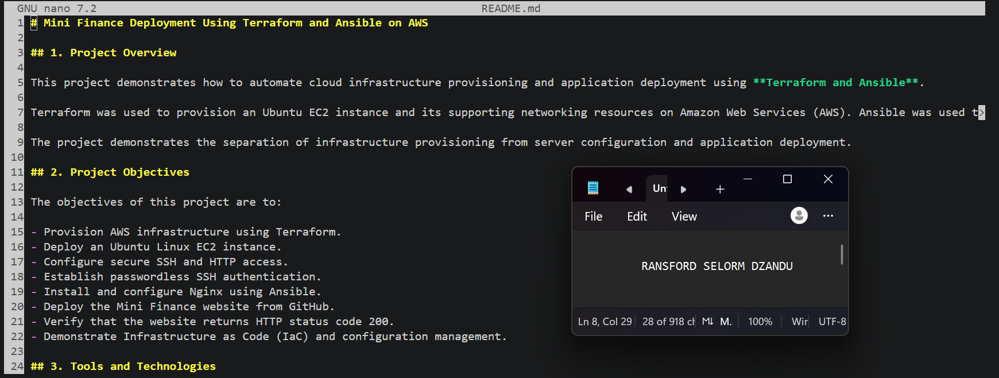

---

### README Content

Copy and paste the complete contents of your `README.md` file below:

```markdown
# Mini Finance Deployment Using Terraform and Ansible on AWS

## 1. Project Overview

This project demonstrates how to automate cloud infrastructure provisioning and application deployment using **Terraform and Ansible**.

Terraform was used to provision an Ubuntu EC2 instance and its supporting networking resources on Amazon Web Services (AWS). Ansible was used to configure the server, install Nginx, and deploy the Mini Finance static website.

The project demonstrates the separation of infrastructure provisioning from server configuration and application deployment.

## 2. Project Objectives

The objectives of this project are to:

- Provision AWS infrastructure using Terraform.
- Deploy an Ubuntu Linux EC2 instance.
- Configure secure SSH and HTTP access.
- Establish passwordless SSH authentication.
- Install and configure Nginx using Ansible.
- Deploy the Mini Finance website from GitHub.
- Verify that the website returns HTTP status code 200.
- Demonstrate Infrastructure as Code (IaC) and configuration management.

## 3. Tools and Technologies

| Tool | Purpose |
|---|---|
| AWS | Cloud infrastructure provider |
| Terraform | Infrastructure provisioning |
| Ansible | Server configuration and application deployment |
| Amazon EC2 | Hosting the Ubuntu server |
| Ubuntu Linux | Server operating system |
| Nginx | Web server |
| Git | Source code management |
| rsync | Website file synchronization |
| SSH | Secure remote server access |

## 4. AWS Infrastructure Provisioned

Terraform was used to provision the following AWS resources:

- **Virtual Private Cloud (VPC):** Provides an isolated network environment.
- **Public Subnet:** Hosts the EC2 instance.
- **Internet Gateway:** Enables internet connectivity.
- **Route Table:** Routes internet traffic through the Internet Gateway.
- **Security Group:** Controls inbound and outbound traffic.
- **EC2 Instance:** Ubuntu Linux server hosting the Mini Finance application.
- **Public IP Address:** Enables SSH access and public website access.

### Security Configuration

The EC2 security group was configured with:

- **SSH (Port 22):** Restricted to the administrator's public IP address.
- **HTTP (Port 80):** Accessible from anywhere (`0.0.0.0/0`).

SSH key authentication was configured to enable secure passwordless access.

## 5. Ansible Deployment Workflow

Ansible was used to automate server configuration and application deployment through a playbook named `site.yml`.

The playbook contains three separate plays.

### Play 1: Install and Configure Nginx

The first play performs the following tasks:

- Updates the Ubuntu package cache.
- Installs Nginx, Git, and rsync.
- Starts the Nginx service.
- Enables Nginx to start automatically after a server reboot.

### Play 2: Deploy the Mini Finance Website

The second play performs the following tasks:

- Clones the Mini Finance application from GitHub.
- Stores the application files in `/opt/mini-finance/`.
- Synchronizes the website files into `/var/www/html/` using `ansible.posix.synchronize`.
- Sets the appropriate file ownership to `www-data:www-data`.
- Reloads Nginx when deployed content changes.

### Play 3: Verify Application Deployment

The third play runs from the Ansible controller and:

- Sends an HTTP request to the EC2 instance's public IP address.
- Checks that the website returns HTTP status code `200`.
- Uses the Ansible `assert` module to verify successful deployment.

## 6. Deployment Verification

The deployment is verified using the following methods.

**SSH Connectivity**

```bash
ssh -i ~/.ssh/id_ed25519 ubuntu@<PUBLIC_IP> "hostname"
```

**Ansible Connectivity**

```bash
ansible web -i inventory.ini -m ping
```

Expected result: `SUCCESS` and `pong`.

**Ansible Playbook Execution**

```bash
ansible-playbook -i inventory.ini site.yml
```

A successful execution should show:

- `failed=0`
- `unreachable=0`
- HTTP status code `200`

**Browser Verification**

The deployed application can be accessed using:

```text
http://<PUBLIC_IP>
```

The website should load successfully with its content and styling displayed correctly.

## 7. Challenges Encountered and Solutions

### Challenge 1: Azure Resource Deployment Restrictions

The assignment initially required deploying the Mini Finance application on Microsoft Azure.

However, Azure subscription restrictions prevented the deployment of the required virtual machine sizes in several regions. Attempts to use alternative regions also encountered resource deployment restrictions.

**Solution:**

I adapted the infrastructure configuration to AWS using the Terraform AWS provider. This allowed me to continue practicing infrastructure provisioning and configuration management using Terraform and Ansible.

### Challenge 2: Terraform Configuration Errors

During AWS infrastructure configuration, Terraform reported syntax errors caused by incorrect semicolons and block formatting.

**Solution:**

I corrected the Terraform configuration syntax, formatted the files using `terraform fmt`, and validated the configuration using `terraform validate` before successfully provisioning the infrastructure.

### Challenge 3: GitHub Repository Access

During the Ansible deployment, the Git clone task stalled because the repository URL provided in the assignment was not accessible.

**Solution:**

I investigated the repository URL and identified an alternative Mini Finance repository:

```text
https://github.com/pravinmishraaws/mini_finance.git
```

The Ansible playbook was updated to use the alternative repository URL, subject to confirming repository accessibility.

## 8. Key Learning Outcomes

Through this project, I learned how to:

- Provision cloud infrastructure using Terraform.
- Configure AWS networking and security groups.
- Deploy and access Ubuntu EC2 instances securely.
- Use SSH keys for passwordless authentication.
- Configure Ansible inventories and test connectivity.
- Write multi-play Ansible playbooks.
- Automate Nginx installation and service management.
- Deploy static websites using Git and rsync.
- Verify application availability using Ansible.
- Troubleshoot Terraform syntax errors, cloud restrictions, and Git repository access issues.

Most importantly, I gained practical experience understanding how **Terraform and Ansible complement each other**.

Terraform manages the infrastructure, while Ansible manages server configuration and application deployment.

## 9. Real-World Application

This workflow can be used by DevOps teams to deploy web applications across development, testing, and production environments.

For example, a company can use Terraform to provision cloud servers and networking infrastructure, while Ansible automatically installs dependencies, configures web servers, and deploys applications.

This approach improves consistency, reduces manual configuration errors, and makes deployments repeatable.

## 10. Conclusion

This project demonstrates how Terraform and Ansible can work together to automate infrastructure provisioning and application deployment.

By combining AWS, Terraform, Ansible, Nginx, Git, and rsync, I gained hands-on experience with Infrastructure as Code, configuration management, deployment automation, and troubleshooting.

The project reinforces the importance of building repeatable, secure, and maintainable cloud deployment workflows.
```

---

# LinkedIn Post Required

## Evidence

#### Screenshot 15 — Published LinkedIn post showing the text and at least one deployment screenshot

Add your screenshot here.

---

#### LinkedIn Post URL

Paste your LinkedIn post URL here:

`Add your URL here`

---

### LinkedIn Submission Notes

**One challenge you faced and how you fixed it:**

Add your answer here.

---

**One real-world example where you can use this learning:**

Add your answer here.

---

# Assignment Questions

Answer the following in your own words:

**1. What did you provision using Terraform in this assignment?**

Add your answer here.

---

**2. What did Ansible configure and deploy in this assignment?**

Add your answer here.

---

**3. Why is SSH access on port `22` restricted to your public IP address?**

Add your answer here.

---

**4. Why is HTTP port `80` open to the internet?**

Add your answer here.

---

**5. What is the purpose of the Ansible inventory file?**

Add your answer here.

---

**6. Why does the playbook use separate plays for install, deploy, and verify?**

Add your answer here.

---

**7. Why is `rsync` useful when deploying website files?**

Add your answer here.

---

**8. What does the Ansible `uri` module verify in this assignment?**

Add your answer here.

---

**9. What issue did you face during this assignment, and how did you fix it?**

Add your answer here.

---

**10. What did you learn from using Terraform and Ansible together?**

Add your answer here.

---

# Required Files

Confirm that the following files are included in your assignment folder:

- [ ] `.gitignore`
- [ ] `README.md`
- [ ] `terraform/providers.tf`
- [ ] `terraform/main.tf`
- [ ] `terraform/variables.tf`
- [ ] `terraform/outputs.tf`
- [ ] `ansible/inventory.ini`
- [ ] `ansible/site.yml`

---

# Submission Instructions

- Add all required screenshots in the correct order.
- Full Name must be visible in required screenshots.
- Add the Azure VM public IP address.
- Add the final Mini Finance website URL.
- Paste `inventory.ini`, `site.yml`, and `README.md` as editable text.
- Answer all assignment questions clearly in your own words.
- Add your LinkedIn post URL.
- Do not expose SSH private keys, passwords, Azure credentials, subscription IDs, Terraform state contents, or other sensitive information.

---

# Completion Checklist

- [ ] Task 1: `mini-finance` project structure created
- [ ] Task 1: `.gitignore` created
- [ ] Task 2: Terraform Azure infrastructure code created
- [ ] Task 2: `Allow-SSH` rule configured for port `22`
- [ ] Task 2: `Allow-HTTP` rule configured for port `80`
- [ ] Task 2: NSG associated with the Network Interface
- [ ] Task 3: `terraform fmt` completed
- [ ] Task 3: `terraform init` completed
- [ ] Task 3: `terraform validate` completed successfully
- [ ] Task 3: `terraform apply` completed successfully
- [ ] Task 3: `terraform output public_ip` displayed the VM public IP
- [ ] Task 4: Passwordless SSH works from the Ansible controller
- [ ] Task 5: `inventory.ini` created
- [ ] Task 5: Ansible ping returns `SUCCESS` and `pong`
- [ ] Task 6: `site.yml` contains three separate plays
- [ ] Task 6: Play 1 installs Nginx, Git, and rsync
- [ ] Task 6: Play 2 clones and deploys the Mini Finance website
- [ ] Task 6: Play 3 verifies HTTP status code `200`
- [ ] Task 7: Playbook syntax check passes
- [ ] Task 7: Ansible playbook completes successfully
- [ ] Task 7: Final recap shows `failed=0` and `unreachable=0`
- [ ] Task 8: Mini Finance website loads in the browser
- [ ] Task 8: Azure VM public IP is visible in the browser screenshot
- [ ] Task 9: `README.md` completed
- [ ] Screenshots 1–15 are included
- [ ] `inventory.ini`, `site.yml`, and `README.md` are pasted as editable text
- [ ] Assignment questions are answered
- [ ] LinkedIn post published with Anyone visibility
- [ ] LinkedIn post URL added
- [ ] No sensitive information is exposed

---

## About DMI & CloudAdvisory

DevOps Micro Internship (DMI) is a project-based DevOps program run by Pravin Mishra and The CloudAdvisory, focused on real-world execution, systems thinking, and career readiness.

It helps learners build strong DevOps foundations with hands-on experience.

---

## Resources

- DMI Official Website: [https://dmi.pravinmishra.com?utm_source=github&utm_medium=readme](https://dmi.pravinmishra.com?utm_source=github&utm_medium=readme)
- University: [https://university.pravinmishra.com?utm_source=github&utm_medium=readme](https://university.pravinmishra.com?utm_source=github&utm_medium=readme)
- Discord Community: [https://discord.pravinmishra.com?utm_source=github&utm_medium=readme](https://discord.pravinmishra.com?utm_source=github&utm_medium=readme)
- Blog: [https://dmi.pravinmishra.com/blog?utm_source=github&utm_medium=readme](https://dmi.pravinmishra.com/blog?utm_source=github&utm_medium=readme)
- YouTube Playlist: [https://www.youtube.com/playlist?list=PLFeSNDtI4Cho](https://www.youtube.com/playlist?list=PLFeSNDtI4Cho)
- Pravin Mishra LinkedIn: [https://www.linkedin.com/in/pravin-mishra-aws-trainer/](https://www.linkedin.com/in/pravin-mishra-aws-trainer/)
- CloudAdvisory LinkedIn: [https://www.linkedin.com/company/thecloudadvisory/](https://www.linkedin.com/company/thecloudadvisory/)

---

*This submission is part of DevOps Micro Internship (DMI) — Agentic AI Track.*