# Assignment — Deploy EpicBook with Terraform and Ansible Roles

Part of the DevOps Micro Internship (DMI) with Agentic AI

---

## Purpose

In this assignment, you will deploy the EpicBook web application using Terraform and Ansible roles.

Terraform provisions the cloud infrastructure, including one Ubuntu VM and one managed MySQL database. Ansible roles configure the VM, install required software, deploy the EpicBook application, configure Nginx, connect the app to the managed MySQL database, and verify the deployment.

---

# Task 1 — Set Up the Project Folder Layout

## Goal

Create the project folder structure for Terraform and Ansible roles.

Terraform will be used to provision the cloud infrastructure. Ansible roles will be used to configure the VM and deploy the EpicBook application.

### Evidence

#### Screenshot 1 — Terminal showing the completed `epicbook-prod` project structure

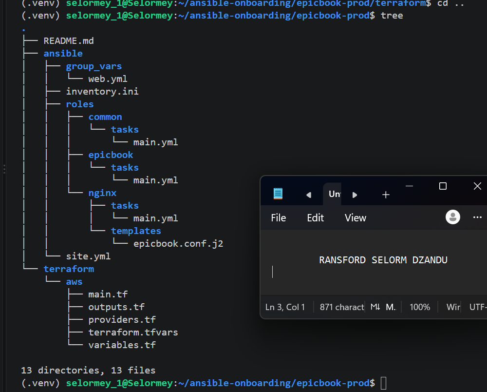

---

### Notes

Answer the following in your own words:

**1. Which cloud provider did you choose for this assignment?**

AWS

---

**2. Why is it useful to keep Terraform files and Ansible files in separate folders?**

Keeping Terraform and Ansible files in separate folders improves project organization and maintainability. Terraform is responsible for provisioning infrastructure such as EC2 instances, security groups, and RDS databases, while Ansible handles server configuration and application deployment. Separating them makes troubleshooting, updating, and managing each component easier.

---

**3. What is the purpose of the `roles` directory in Ansible?**

The roles directory organizes Ansible automation into reusable and manageable components. Each role contains tasks, templates, handlers, and other files for a specific purpose. In the EpicBook project, the common role installs essential packages, the nginx role configures the web server, and the epicbook role deploys and manages the application. This makes the playbook cleaner, easier to maintain, and reusable across deployments.

---

# Task 2 — Provision the Infrastructure with Terraform

## Goal

Run Terraform to provision the cloud infrastructure for the EpicBook deployment.

Terraform will create the VM, managed MySQL database, networking, security rules, and required outputs.

### Evidence

#### Screenshot 2 — `terraform apply` completed successfully

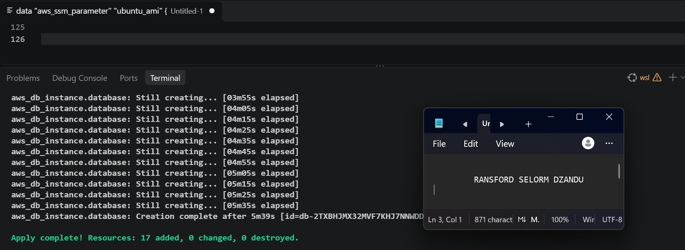

---

#### Screenshot 3 — Output of `terraform output`

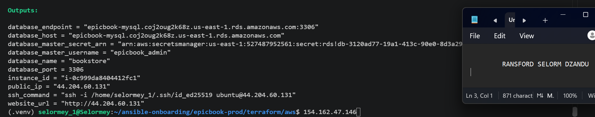

---

#### Screenshot 4 — Azure Portal or AWS Console showing the VM running

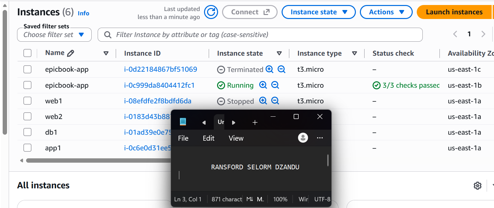

---

#### Screenshot 5 — Azure Portal or AWS Console showing the managed MySQL database created

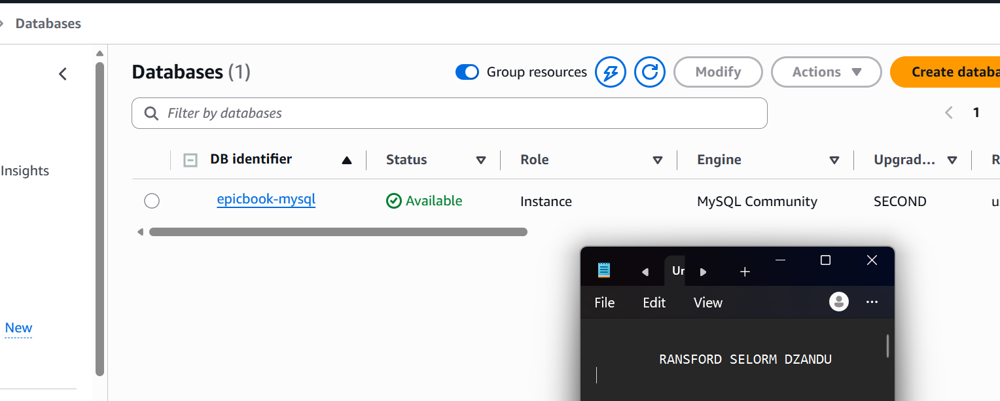

---

### Notes

Answer the following in your own words:

**1. What resources did Terraform create for this assignment?**

Terraform provisioned the AWS infrastructure required to deploy the EpicBook application. This included a VPC, subnet, route table, internet gateway, security groups, an EC2 instance to host the application, and an Amazon RDS MySQL database for storing application data.

---

**2. Why should you review `terraform plan` before running `terraform apply`?**

Reviewing terraform plan helps identify the infrastructure changes Terraform intends to make before applying them. It allows us to detect configuration errors, unexpected resource changes, or accidental deletions. This helps prevent mistakes, unnecessary costs, and disruptions to existing infrastructure.

---

**3. Why should database passwords not be shown in Terraform output?**

Database passwords should not be displayed in Terraform output because they are sensitive credentials. Exposing them could allow unauthorized users to access the database and compromise application data. Passwords should be managed securely using services like AWS Secrets Manager, and sensitive Terraform outputs should be protected.

---

# Task 3 — Verify SSH Key-Based Access

## Goal

Verify that the cloud VM can be accessed from the Ansible controller using SSH key-based authentication.

### Evidence

#### Screenshot 6 — Successful SSH hostname check from the Ansible controller

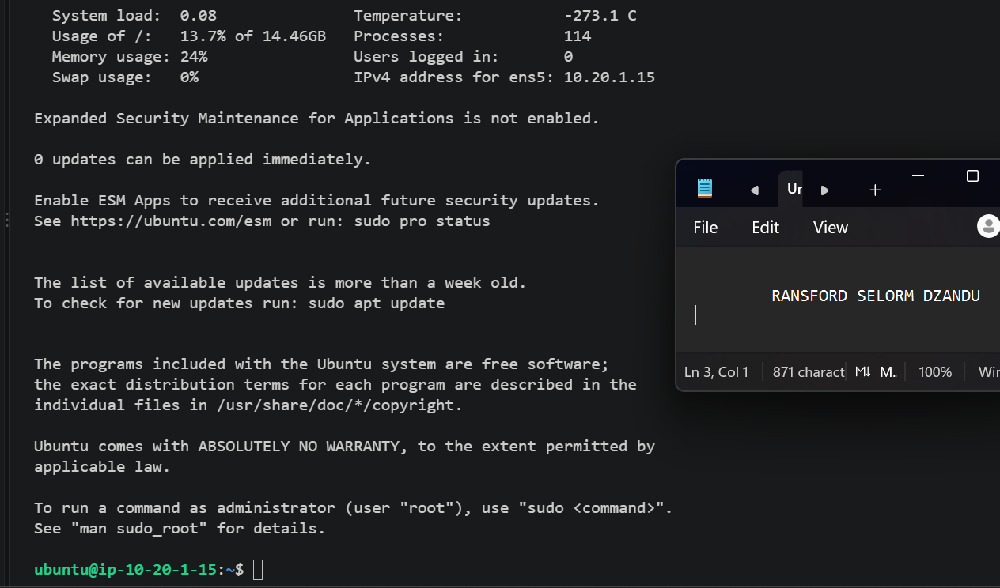

---

### Notes

Answer the following in your own words:

**1. What command did you use to verify SSH access?**

ssh -i ~/.ssh/id_ed25519 ubuntu@44.204.60.131

---

**2. What proves that SSH key-based access worked successfully?**

SSH key-based access was successful because I was able to connect to the EC2 instance using my private SSH key without entering a server password. The terminal displayed the Ubuntu server prompt (ubuntu@ip-10-20-1-15:~$), confirming that authentication and remote access worked successfully.

---

**3. What would you check if SSH returned `Permission denied (publickey)`?**

I would check that I am using the correct private SSH key, the correct username (ubuntu), and the correct EC2 public IP address. I would also verify that the private key has the appropriate permissions (chmod 600 ~/.ssh/id_ed25519) and that its corresponding public key is authorized on the EC2 instance.

---

# Task 4 — Create the Ansible Inventory and Configuration

## Goal

Create the Ansible inventory file and local Ansible configuration for the EpicBook VM.

The inventory tells Ansible which VM to manage and which SSH user to use.

### Evidence

#### Screenshot 7 — `inventory.ini` showing the VM under the `web` group

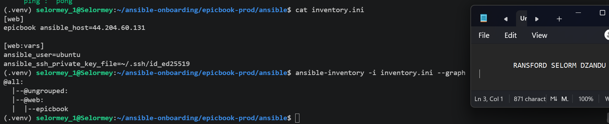

---

#### Screenshot 8 — Output of `ansible-inventory -i inventory.ini --graph`

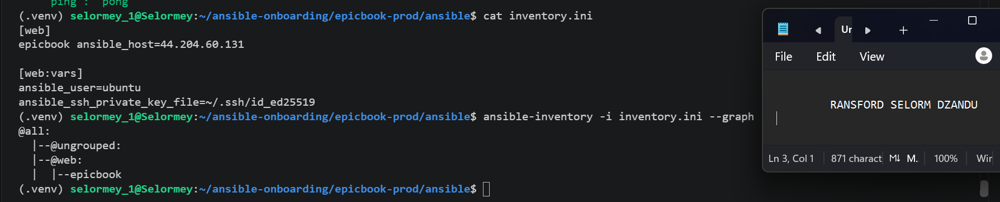

---

#### Screenshot 9 — Output of `ansible web -i inventory.ini -m ping`

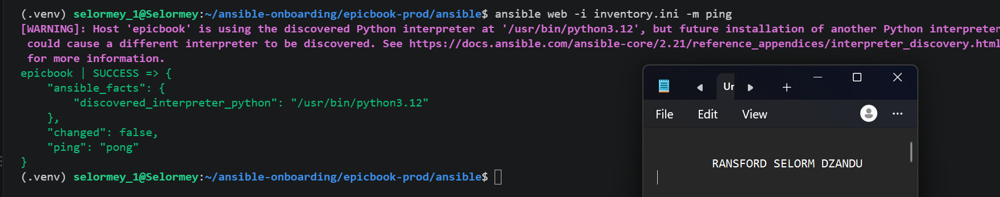

---

### Notes

Answer the following in your own words:

**1. What is the purpose of `inventory.ini`?**

The inventory.ini file defines the servers that Ansible manages. It organizes servers into groups and specifies connection details such as IP addresses, SSH usernames, and private key paths. In the EpicBook project, it allows Ansible to connect to the EC2 instance and execute deployment tasks.

---

**2. What does `ansible_host` store?**

The ansible_host variable stores the IP address or hostname of the target server Ansible connects to. In the EpicBook project, it stores the EC2 instance's public IP address (44.204.60.131).

---

**3. What does `ansible_ssh_private_key_file` tell Ansible?**

The ansible_ssh_private_key_file variable tells Ansible the location of the private SSH key used to authenticate with the target server. In the EpicBook project, it points to ~/.ssh/id_ed25519, allowing Ansible to securely connect to the EC2 instance without requiring a password.

---

**4. Why is `host_key_checking = False` used only for this temporary lab?**

Setting host_key_checking = False allows Ansible to connect to servers without verifying their SSH host keys, making connections easier during temporary lab exercises. However, it reduces security by increasing the risk of man-in-the-middle attacks. In production environments, host key checking should remain enabled to verify server identities and ensure secure SSH connections.

---

# Task 5 — Create the Main Ansible Playbook

## Goal

Create the main Ansible playbook that runs the required roles in the correct order.

The `site.yml` file will call the `common`, `nginx`, and `epicbook` roles.

### Evidence

#### Screenshot 10 — `site.yml` showing the roles in the correct order

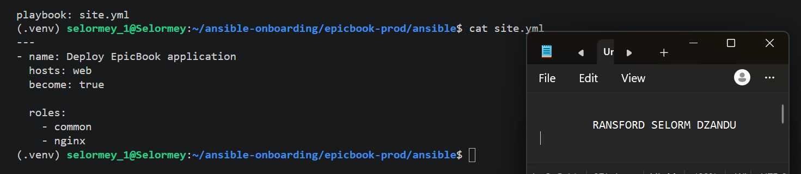

---

#### Screenshot 11 — Output of `ansible-playbook -i inventory.ini site.yml --syntax-check`

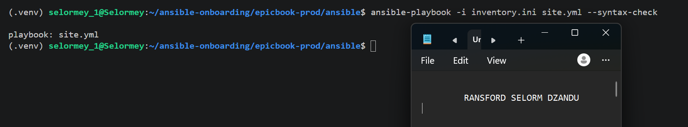

---

### Notes

Answer the following in your own words:

**1. What is the purpose of `site.yml`?**

The site.yml file is the main Ansible playbook that controls the deployment of the EpicBook application. It defines the target servers and specifies which roles should run to configure the server, install Nginx, and deploy the application.

---

**2. Why should the roles run in the order `common`, `nginx`, and `epicbook`?**

The roles should run in this order to ensure that each stage prepares the environment for the next. The common role installs essential system packages, the nginx role configures the web server and reverse proxy, and the epicbook role deploys and manages the application. This order helps ensure a structured and reliable deployment.

---

**3. What does `become: true` allow Ansible to do?**

The become: true setting allows Ansible to execute tasks with elevated privileges, usually as the root user. This is necessary for operations such as installing packages, modifying system configuration files, and managing services like Nginx.

---

# Task 6 — Create the `common` Role

## Goal

Create the `common` role to prepare the Ubuntu VM with the basic packages required for the EpicBook deployment.

This role handles the common server setup before Nginx and the application are configured.

### Evidence

#### Screenshot 12 — `roles/common/tasks/main.yml` showing the common setup tasks

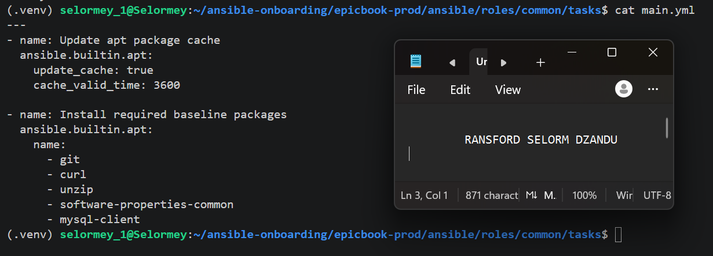

---

### Notes

Answer the following in your own words:

**1. What is the responsibility of the `common` role?**

The common role prepares the EC2 instance for deployment by installing essential system packages and tools such as Git, curl, and mysql-client. It ensures the server has the basic dependencies required by the other Ansible roles.

---

**2. Why should Nginx installation not be placed inside the `common` role?**

Nginx installation should be handled by a separate nginx role to maintain proper organization and separation of responsibilities. The common role focuses on general system setup, while the nginx role handles web server installation and configuration. This makes the roles easier to maintain, troubleshoot, and reuse.

---

**3. Why is `mysql-client` useful in this deployment?**

The mysql-client package allows the EC2 instance to connect to the Amazon RDS MySQL database. It is useful for testing database connectivity, running SQL queries, and importing the EpicBook database schema and seed data during deployment

---

# Task 7 — Create the `nginx` Role

## Goal

Create the `nginx` role to install Nginx and configure it as a reverse proxy for the EpicBook application.

Nginx will receive browser traffic on port `80` and forward it to the EpicBook Node.js application running on the VM.

### Evidence

#### Screenshot 13 — `roles/nginx/tasks/main.yml` showing Nginx installation and site configuration tasks

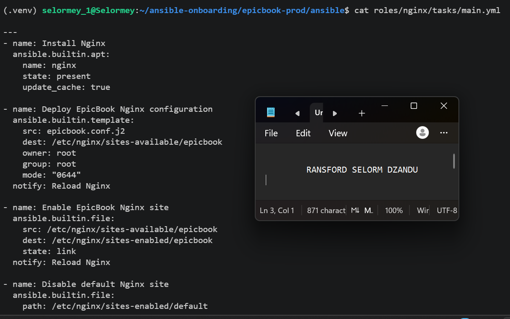

---

#### Screenshot 14 — `roles/nginx/templates/epicbook.conf.j2` showing the reverse proxy configuration

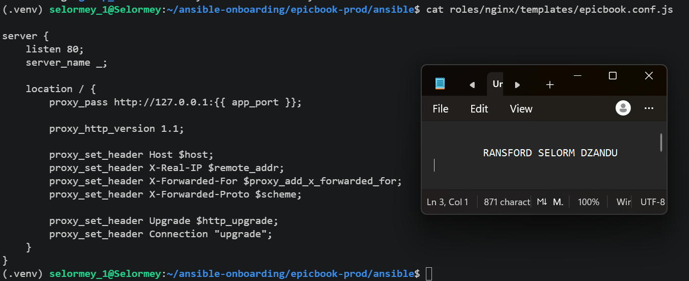

---

### Notes

Answer the following in your own words:

**1. What is the responsibility of the `nginx` role?**

The nginx role is responsible for installing, configuring, and managing the Nginx web server on the EC2 instance. It sets up Nginx as a reverse proxy, forwards incoming HTTP requests to the EpicBook application, and ensures the Nginx service is running and enabled.

---

**2. Why is Nginx configured as a reverse proxy in this deployment?**

Nginx is configured as a reverse proxy to receive HTTP requests from users on port 80 and forward them to the EpicBook Node.js application running on port 8080. This allows users to access the application through the EC2 public IP address without specifying port 8080. It also provides a central point for managing incoming web traffic.

---

**3. Why should the application port come from `group_vars/web.yml` instead of being hard-coded?**

Defining the application port in group_vars/web.yml makes the configuration more flexible, reusable, and easier to maintain. Instead of changing the port manually in multiple files, it can be updated in one central location. This also ensures consistency between the Nginx reverse proxy and the EpicBook application, reducing configuration errors.

---

# Task 8 — Create the `epicbook` Role

## Goal

Create the `epicbook` role to deploy the EpicBook application, connect it to the managed MySQL database, and run the application on port `8080` using PM2.

### Evidence

#### Screenshot 15 — `roles/epicbook/tasks/main.yml` showing application deployment tasks

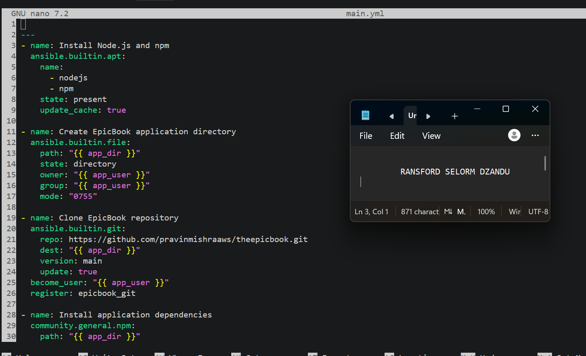

---

#### Screenshot 16 — Task or file showing how the database connection is configured, with secrets hidden

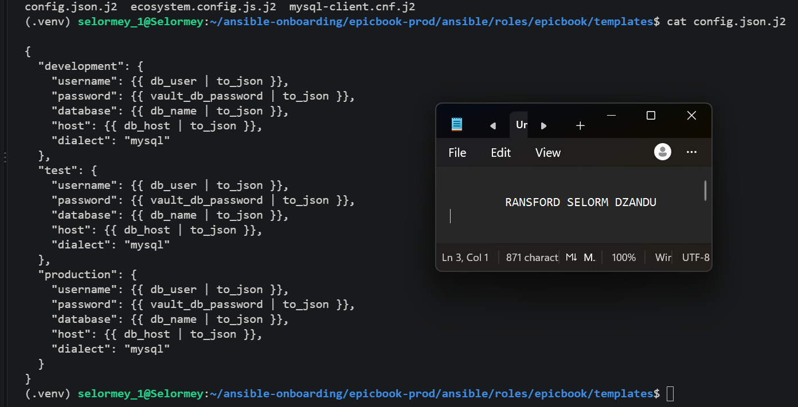

---

#### Screenshot 17 — Task or output showing the EpicBook application managed by PM2

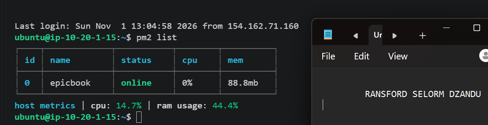

---

### Notes

Answer the following in your own words:

**1. What is the responsibility of the `epicbook` role?**

The epicbook role is responsible for deploying and configuring the EpicBook Node.js application on the EC2 instance. It installs Node.js and required dependencies, clones the application repository, configures the database connection, imports database scripts, and uses PM2 to manage the application process

---

**2. Why is PM2 used for the EpicBook Node.js application?**

PM2 is used to manage the EpicBook Node.js application and keep it running in the background. It automatically restarts the application if it crashes, supports application monitoring, and helps ensure the application remains available without manually restarting it

---

**3. Why should database passwords not be hard-coded in public files?**

Database passwords should not be hard-coded in public files because they could be exposed to unauthorized users, putting the database and application data at risk. Using secure methods such as Ansible Vault or AWS Secrets Manager protects sensitive credentials and makes the deployment more secure.

---

**4. What does it mean for the application to run on port `8080` while Nginx listens on port `80`?**

It means the EpicBook Node.js application runs internally on port 8080, while Nginx receives incoming HTTP requests from users on port 80. Nginx acts as a reverse proxy, forwarding these requests to the application on port 8080. This allows users to access EpicBook through the EC2 public IP address without specifying the application port.

---

# Task 9 — Create Group Variables

## Goal

Create reusable variables for the EpicBook deployment.

The `group_vars/web.yml` file stores values that can be reused across the Ansible roles.

### Evidence

#### Screenshot 18 — `group_vars/web.yml` showing the application, PM2, and database variables, with passwords hidden or masked

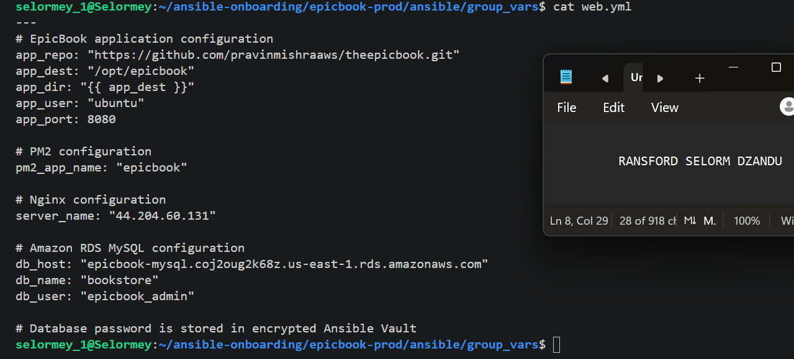

---

### Notes

Answer the following in your own words:

**1. What is the purpose of `group_vars/web.yml`?**

The group_vars/web.yml file stores reusable configuration variables for the EpicBook deployment. It allows different Ansible roles to access shared values without hard-coding them, making the deployment easier to manage, update, and maintain.

---

**2. Which values did you store in `group_vars/web.yml`?**

I stored the EpicBook GitHub repository URL, application destination path, application user, application port (8080), PM2 process name (epicbook), Nginx server name, Amazon RDS MySQL endpoint, database name (bookstore), and database username (epicbook_admin). I also included a reference to the database password stored in Ansible Vault.

---

**3. How did you handle the database password securely?**

I used Ansible Vault to encrypt and protect the database password instead of storing it directly in group_vars/web.yml. The file references the encrypted variable using {{ vault_db_password }}. When running the playbook, I use --ask-vault-pass to unlock the encrypted credentials securely, preventing the database password from being exposed in public files or GitHub.

---

# Task 10 — Run the Ansible Playbook

## Goal

Run the Ansible playbook to configure the VM and deploy the EpicBook application.

The playbook should run the roles in this order:

1. `common`
2. `nginx`
3. `epicbook`

### Evidence

#### Screenshot 19 — Ansible playbook output showing the roles running

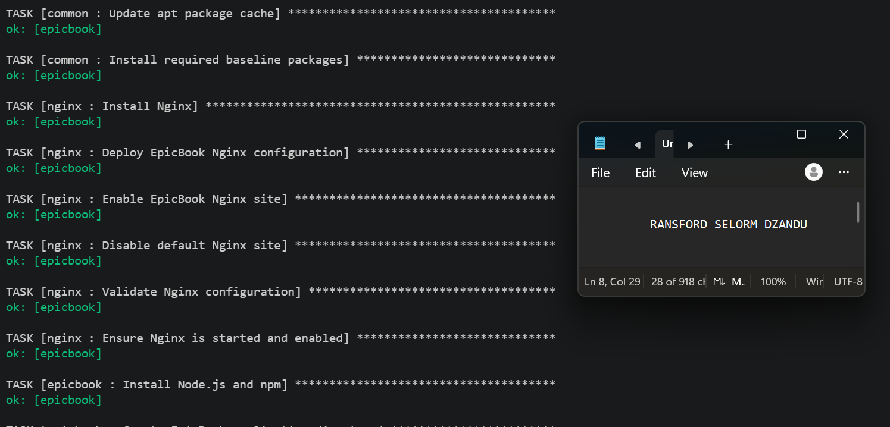

---

#### Screenshot 20 — Final Ansible recap showing `failed=0`

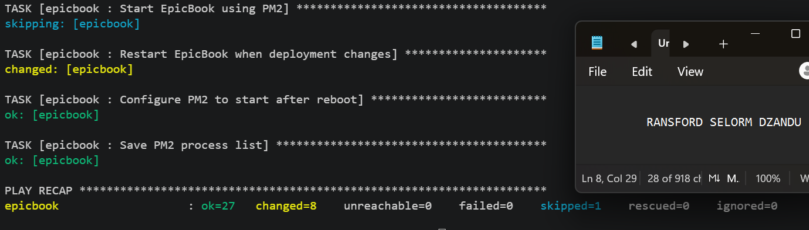

---

#### Screenshot 21 — Output of `ansible web -i inventory.ini -m command -a "systemctl is-active nginx" --become`

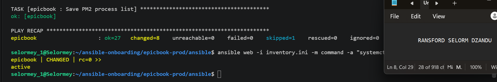

---

#### Screenshot 22 — Output of `ansible web -i inventory.ini -m command -a "pm2 status"`

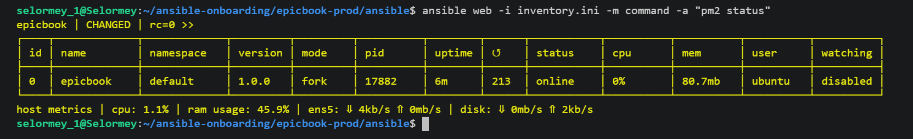

---

#### Screenshot 23 — Output of `ansible web -i inventory.ini -m command -a "curl -I http://localhost:8080"`

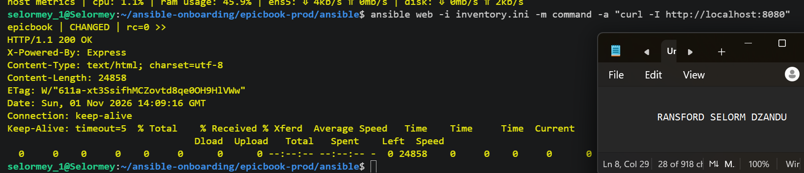

---

### Notes

Answer the following in your own words:

**1. What command did you run to execute the Ansible playbook?**

ansible-playbook -i inventory.ini site.yml --ask-vault-pass

---

**2. How do you know all roles completed successfully?**

I can confirm that all roles completed successfully by checking the final PLAY RECAP output. A successful deployment should show failed=0 and unreachable=0, indicating that Ansible completed the tasks without failures. The output also shows the tasks executed by the common, nginx, and epicbook roles.

---

**3. What proves that Nginx is active?**

if this command returns active. 
ansible web -i inventory.ini -m command -a "systemctl is-active nginx" --become

---

**4. What proves that PM2 is managing the EpicBook application?**

if i run ansible web -i inventory.ini -m command -a "pm2 status" and the output lists the epicbook process with its status online, i know PM2 is managing the epicbook application

---

**5. What proves that the EpicBook application responds on port `8080`?**

ansible web -i inventory.ini -m command -a "curl -I http://localhost:8080"

A successful HTTP response, such as 200 OK, confirms that the application is responding to requests on port 8080. If the connection fails, it indicates that the application may not be running or listening on the expected port.

---

# Task 11 — Verify the EpicBook Deployment

## Goal

Verify that the EpicBook application is running, accessible in the browser, and connected to the managed MySQL database.

### Evidence

#### Screenshot 24 — Output of `curl -I http://<public_ip>`

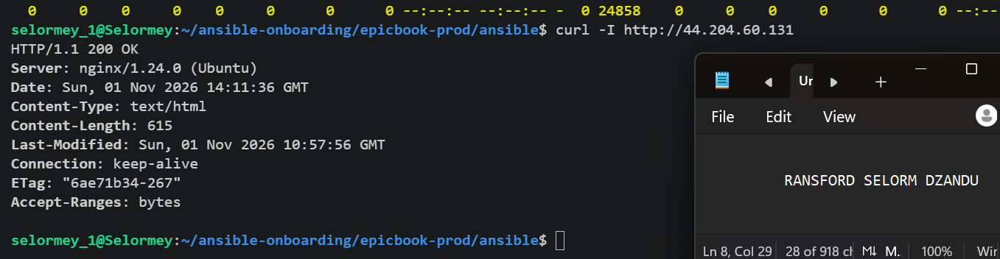

---

#### Screenshot 25 — Output of the cart API test command

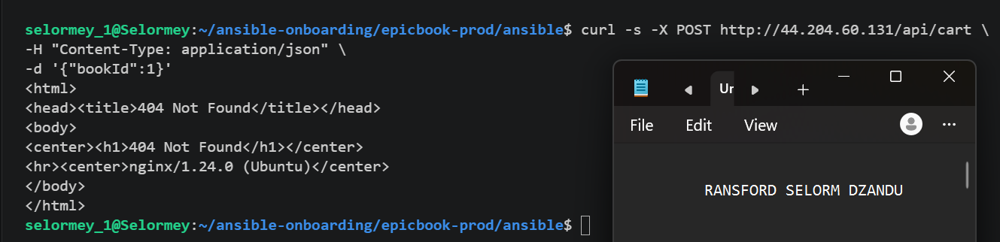

---

#### Screenshot 26 — Output of the `/cart` HTTP status check

---

#### Screenshot 27 — Browser showing the EpicBook application loaded from `http://<public_ip>`

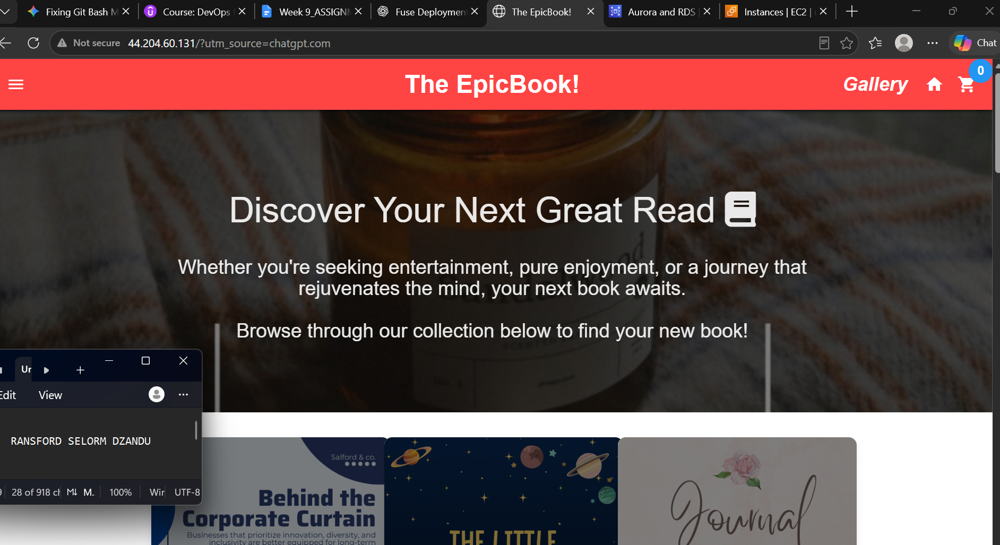

---

### Notes

Answer the following in your own words:

**1. What HTTP response did you receive from the public application URL?**

When I accessed the public application URL, the server displayed the default Nginx welcome page instead of the EpicBook application. This confirmed that Nginx was running, but the application was not being served correctly.

---

**2. What did the cart API test prove?**

The cart API test was intended to verify that HTTP requests could reach the EpicBook Node.js application and that the application could interact with the managed MySQL database. A successful JSON response would confirm that the cart API was functioning. However, I have not yet confirmed a successful result.

---

**3. What did the `/cart` status check return?**

I used the /cart status check to verify whether the cart page was accessible. The expected HTTP status was 200 OK, but I have not yet confirmed the actual status returned during testing.

---

**4. What issue did you face during verification, and how did you fix it?**

During verification, I encountered an issue where the public IP address displayed the Nginx welcome page instead of the EpicBook application. After troubleshooting, I discovered that the Nginx configuration template (epicbook.conf.j2) was empty, while the correct configuration was saved in epicbook.conf.js. I copied the correct configuration into the .j2 template so Ansible could deploy it properly. The remaining step was to redeploy Nginx and verify that EpicBook loaded successfully.

---

# LinkedIn Post Required

## Evidence

#### LinkedIn Post URL

Paste your LinkedIn post URL here:

`Add your URL here`

---

#### Screenshot — Published LinkedIn post

Add your screenshot here.

---

# Assignment Questions

Answer the following in your own words:

**1. Why is Terraform used for infrastructure provisioning?**

Terraform is used to automate the creation and management of cloud infrastructure using Infrastructure as Code (IaC). It allows resources such as EC2 instances, VPCs, security groups, and RDS databases to be provisioned consistently and efficiently. This reduces manual configuration errors and makes infrastructure easier to manage and reproduce.

---

**2. Why are Ansible roles useful for production-style deployments?**

Ansible roles help organize deployment tasks into reusable and manageable components. Each role handles a specific responsibility, such as installing system packages, configuring Nginx, or deploying the EpicBook application. This makes deployments more consistent, easier to troubleshoot, maintain, and scale across multiple servers.

---

**3. What is the purpose of `group_vars/web.yml`?**

The group_vars/web.yml file stores shared configuration variables used by Ansible roles. In the EpicBook project, it contains application settings, PM2 configuration, Nginx server details, and database connection information. This reduces hard-coded values, improves consistency, and makes it easier to update deployment settings from one central location.

---

**4. Why should database passwords not be committed to GitHub?**

Database passwords should not be committed to GitHub because unauthorized users could access them and compromise the database. Sensitive credentials should be protected using secure tools such as Ansible Vault or AWS Secrets Manager to prevent unauthorized access and data breaches.

---

**5. What is the purpose of Nginx in this deployment?**

Nginx acts as a reverse proxy that receives HTTP requests on port 80 and forwards them to the EpicBook Node.js application running on port 8080. This allows users to access the application through the EC2 public IP address without specifying the application port.

---

**6. Why should the managed MySQL database not be publicly accessible?**

Nginx acts as a reverse proxy that receives HTTP requests on port 80 and forwards them to the EpicBook Node.js application running on port 8080. This allows users to access the application through the EC2 public IP address without specifying the application port.

---

**7. Why is PM2 used for the EpicBook Node.js application?**

PM2 is used to manage the EpicBook Node.js application and keep it running in the background. It automatically restarts the application if it crashes, provides process monitoring, and helps maintain application availability.

---

**8. What does idempotency mean in Ansible?**

Idempotency means that running the same Ansible playbook multiple times produces the same desired configuration without making unnecessary changes. For example, if Nginx is already installed and correctly configured, Ansible will not reinstall or modify it unless changes are required.

---

**9. What issue did you face during the deployment, and how did you fix it?**

During deployment, I encountered an issue where the public IP address displayed the default Nginx welcome page instead of the EpicBook application. After troubleshooting, I discovered that the Nginx configuration template (epicbook.conf.j2) was empty, while the correct configuration was stored in epicbook.conf.js. I copied the correct configuration into the .j2 template so Ansible could use it during deployment. The fix still required redeployment and verification.

---

**10. What security improvement would you make before using this setup in production?**

Before deploying this setup to production, I would configure HTTPS using an SSL/TLS certificate to encrypt communication between users and the EpicBook application. I would also enable SSH host key verification, restrict SSH access to trusted IP addresses, and continue managing database credentials securely using AWS Secrets Manager or Ansible Vault.

---

# Required Files

Confirm that the following files are included in your GitHub repository or assignment folder:

- [ ] `README.md`
- [ ] Terraform files under either `terraform/azure/` or `terraform/aws/`
- [ ] `ansible/ansible.cfg`
- [ ] `ansible/inventory.ini`
- [ ] `ansible/site.yml`
- [ ] `ansible/group_vars/web.yml`
- [ ] `ansible/roles/common/tasks/main.yml`
- [ ] `ansible/roles/nginx/tasks/main.yml`
- [ ] `ansible/roles/nginx/templates/epicbook.conf.j2`
- [ ] `ansible/roles/epicbook/tasks/main.yml`

---

# Submission Instructions

- Add all required screenshots in your submission.
- Full Name must be visible in required screenshots.
- Mention the cloud provider used: Azure or AWS.
- Add the VM public IP address.
- Add the final application URL.
- Add Terraform output proof.
- Add Ansible role tree proof.
- Add all required notes and assignment question answers.
- Add your LinkedIn post URL.
- Do not expose SSH private keys, passwords, cloud credentials, database credentials, Terraform state files, subscription IDs, or account IDs.

---

# Completion Checklist

- [ ] Task 1: Project folder layout created
- [ ] Task 2: Terraform infrastructure provisioned
- [ ] Task 3: SSH key-based access verified
- [ ] Task 4: Ansible inventory and configuration created
- [ ] Task 5: Main Ansible playbook created
- [ ] Task 6: `common` role created
- [ ] Task 7: `nginx` role created
- [ ] Task 8: `epicbook` role created
- [ ] Task 9: Group variables created
- [ ] Task 10: Ansible playbook run completed
- [ ] Task 11: EpicBook deployment verified
- [ ] Terraform files created under only one cloud provider folder
- [ ] One Ubuntu VM was created
- [ ] One managed MySQL database was created
- [ ] SSH port `22` is restricted to the controller public IP
- [ ] HTTP port `80` is accessible
- [ ] MySQL port `3306` is not publicly open
- [ ] `ansible web -i inventory.ini -m ping` returns `SUCCESS`
- [ ] `site.yml` calls the roles in the correct order
- [ ] Database secrets are hidden or handled securely
- [ ] Nginx is active
- [ ] PM2 shows the EpicBook application running
- [ ] EpicBook responds on port `8080`
- [ ] Public URL loads in the browser
- [ ] Cart API verification works
- [ ] Playbook completes with `failed=0`
- [ ] Screenshots 1–27 are included
- [ ] Assignment questions are answered
- [ ] LinkedIn post published
- [ ] LinkedIn post URL added
- [ ] No sensitive information is exposed

---

## About DMI & CloudAdvisory

DevOps Micro Internship (DMI) is a project-based DevOps program run by Pravin Mishra and The CloudAdvisory, focused on real-world execution, systems thinking, and career readiness.

It helps learners build strong DevOps foundations with hands-on experience.

---

## Resources

- DMI Official Website: [https://dmi.pravinmishra.com?utm_source=github&utm_medium=readme](https://dmi.pravinmishra.com?utm_source=github&utm_medium=readme)
- University: [https://university.pravinmishra.com?utm_source=github&utm_medium=readme](https://university.pravinmishra.com?utm_source=github&utm_medium=readme)
- Discord Community: [https://discord.pravinmishra.com?utm_source=github&utm_medium=readme](https://discord.pravinmishra.com?utm_source=github&utm_medium=readme)
- Blog: [https://dmi.pravinmishra.com/blog?utm_source=github&utm_medium=readme](https://dmi.pravinmishra.com/blog?utm_source=github&utm_medium=readme)
- YouTube Playlist: [https://www.youtube.com/playlist?list=PLFeSNDtI4Cho](https://www.youtube.com/playlist?list=PLFeSNDtI4Cho)
- Pravin Mishra LinkedIn: [https://www.linkedin.com/in/pravin-mishra-aws-trainer/](https://www.linkedin.com/in/pravin-mishra-aws-trainer/)
- CloudAdvisory LinkedIn: [https://www.linkedin.com/company/thecloudadvisory/](https://www.linkedin.com/company/thecloudadvisory/)

---

*This submission is part of DevOps Micro Internship (DMI) — Agentic AI Track.*