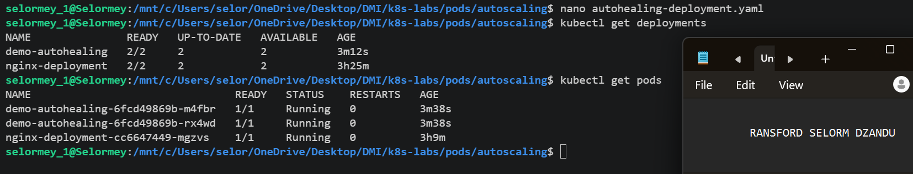
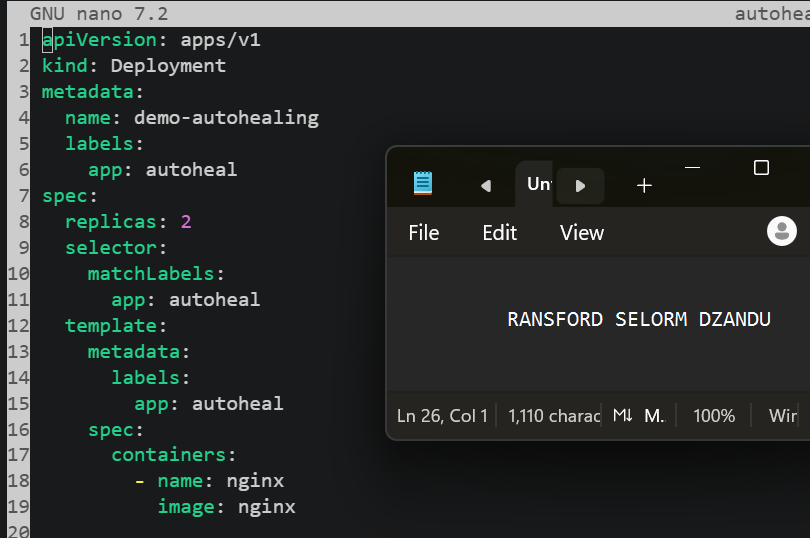
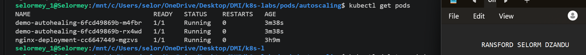
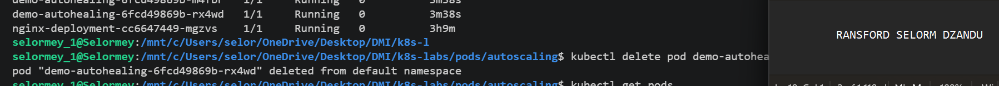
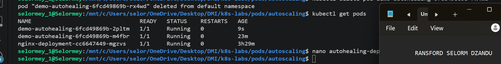

# Assignment 4 — Auto-Scaling & Auto-Healing: Let Kubernetes React for You

Part of the DevOps Micro Internship (DMI) with Agentic AI

---

## Purpose

In this guided lab, you will prove Deployment auto-healing by deleting a Pod, then configure a CPU-based Horizontal Pod Autoscaler that maintains between two and five NGINX Pods.

---

# Task 1 — Set Up the Lab Directory

## Goal

Create the `~/k8s-labs/autoscaling` working directory.

### Evidence

#### Screenshot 1 — Terminal showing the `autoscaling` directory

---

# Task 2 — Prove Deployment Auto-Healing

## Goal

Create `demo-autohealing` (two replicas), delete one Pod, and confirm the desired count of two is restored automatically.

### Evidence

#### Screenshot 2 — Deleted Pod and replacement Pod with the replica count restored

---

# Task 3 — Create the HPA-Ready Deployment and Enable Metrics

## Goal

Deploy `nginx-deployment` with CPU `requests: 100m` / `limits: 200m`, then enable Metrics Server (Minikube addon or manifest + kubelet TLS patch for kind) and confirm it reports `READY 1/1`.

### Evidence

#### Screenshot 3 — Deployment resources plus successful Metrics Server status

---

# Task 4 — Create and Inspect the HPA

## Goal

Create an HPA (imperatively via `kubectl autoscale` or declaratively via `autoscaling/v2`) targeting `nginx-deployment` with min 2, max 5, and 50% target CPU utilization.

### Evidence

#### Screenshot 4 — `kubectl get hpa` and `kubectl describe hpa nginx-hpa` output

---

# Task 5 — Optionally Generate CPU Load

## Goal

Generate CPU load inside an NGINX Pod (`yes > /dev/null`) and monitor whether the HPA increases replicas.

### Evidence

#### Screenshot 5 — HPA output showing current metrics and any replica increase

---

### Notes

Write a short note describing what the lab demonstrated.

This lab demonstrated how Kubernetes uses **auto-healing and auto-scaling** to improve application reliability and availability. Auto-healing allows Kubernetes to automatically replace deleted or failed Pods to maintain the desired number of replicas. Auto-scaling uses the **Horizontal Pod Autoscaler (HPA)** to adjust the number of Pods based on CPU utilization. The lab also demonstrated the importance of CPU requests, limits, and Metrics Server in monitoring resource usage and supporting automatic scaling. Overall, I learned how Kubernetes helps applications recover from failures and adapt to changing workloads with minimal manual intervention.

---

# Submission Instructions

- Add all required screenshots in your submission
- Include the completed YAML manifests used in the lab

---

# Completion Checklist

- [ ] Task 1: Lab directory created (Screenshot 1)
- [ ] Task 2: Auto-healing observed (Screenshot 2)
- [ ] Task 3: HPA-ready Deployment applied and Metrics Server verified (Screenshot 3)
- [ ] Task 4: HPA created and inspected (Screenshot 4)
- [ ] Task 5: CPU load generated and scaling observed (Screenshot 5, optional)
- [ ] Reflection notes written (Notes)

---

## 📌 About DMI & CloudAdvisory

DevOps Micro Internship (DMI) is a project-based DevOps program run by Pravin Mishra (The CloudAdvisory) focused on real-world execution, systems thinking, and career readiness.

It helps learners build strong DevOps foundations with hands-on experience.

---

## 📌 Resources

- 🌐 DMI Official Website: https://dmi.pravinmishra.com?utm_source=github&utm_medium=readme  
- 🎓 University: https://university.pravinmishra.com?utm_source=github&utm_medium=readme  
- 💬 Discord Community: https://discord.pravinmishra.com?utm_source=github&utm_medium=readme  
- 📝 Blog: https://dmi.pravinmishra.com/blog?utm_source=github&utm_medium=readme  
- ▶️ YouTube Playlist: https://www.youtube.com/playlist?list=PLFeSNDtI4Cho  
- 🔗 Pravin Mishra (LinkedIn): https://www.linkedin.com/in/pravin-mishra-aws-trainer/  
- 🏢 CloudAdvisory (LinkedIn): https://www.linkedin.com/company/thecloudadvisory/

---

*This submission is part of DevOps Micro Internship (DMI) — Agentic AI Track.*
